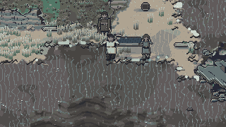
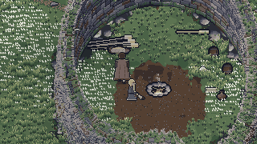

# THE USER'S THIRD PLAYTEST: THE STORY (Hild's lead, the shelter in stages, Thorkel taken by the sea)

In the Book 2 section 23 format: one heading per report field. This builds decisions DG-12, DG-13 and
DG-14 (and the sounds of DG-29 that are theirs) of the user's third playtest, beside the combat
build and the interface build, which other sessions make in the same working tree at the same time.
The choices the books left open, and the departures, are DG-50 to DG-67 in `docs/decision-log.md`
("Building the story"). Nothing is committed by this session.

## Implemented
**Hild points north (DG-13).** Set down above the tide line, after her first line, Hild says "There's
an old tower up on the bank, north of here. Go and see if it'll keep the wind off us." (3.5 s after
it, so the two lines never arrive in one frame; DG-52), and names the chest after it. A new aim,
"See the old tower" (journal "Go up to the old tower to the north."), comes before the chest's, with
its two hints, and is done on reaching the broch or with the chest home. `src/sim/narrative/wreck.ts`
(`stepWreck`), `content/opening.json` (`rework.broch`, the aims).

**The shelter in three stages over two days (DG-12).** The fact `ch1.shelter` (FOLDED, FRAME, SAIL,
FINISHED) replaces `ch1.shelter_raised` throughout (`src/sim/home/camp.ts` `shelterStage`,
`leanToUp`, `shelterFinishOpen`; DG-50):
- **The frame** (day 1): one hands-on action at the sail's place (`TASK_SHELTER_FRAME`, Book 10
  `shelterFrame`: 5 s, 15 game minutes, 1 stamina), drawn going up frame by frame under the build
  loop while Hild steadies the oars beside the steerer (her own build loop at content `steady`); its
  sound across the loop (`SFX_SHELTER_FRAME`).
- **The sail and lashings** (day 1): the second action (`TASK_SHELTER_SAIL`, `shelterSail`), the
  cloth hauled over the ridge and lashed along it, half lashed with its top corner flogging, its foot
  weighted with stones, then filling and settling into the lean-to (the approved
  `prop_sail_leanto`); the haul's sound across the loop and the cloth filling at its end. The
  household sleeps under the lean-to from the first night, as before; its flap hangs once the sail is
  lashed (a door's fact may now be `key=A|B`, DG-62).
- **The finished shelter** (day 2): the `shelter` site's Build action and the residents' BUILDER job
  open from 06:00 on day 2 and not before (`shelterFinish`; the job `needs: SHELTER_FINISH`). The S1
  shelter comes at Book 10's 1 worker-day (480 worker-minutes) by anyone's work: Hild takes it as her
  day's job while the stores hold the next day's food (else she fishes first, DG-56), Runa as the
  builder, the steerer's Build actions; turves are drawn stacking on the weather side as the work
  goes. Finished, the household sleeps in the S1 beds.
- **Hild's word at each stage** (`shelterHildLines`; Book 8 section 05): the frame's step 4 s after
  her walk-up's aim; the sail's when the frame stands; "There. A roof. Of sorts." and, 4 s later,
  "We'll make it a proper one in the morning."; on the second morning within 10 tiles of the steerer
  at the camp, awake, "The lashings stretched in the wet..."; "Now that's a shelter..." when it is
  finished (owed if she is away). Each stage is an aim with its two hints (the stuck-help rules of
  2.4): "Raise the frame", "Raise the shelter", "Finish the shelter" (DG-53).

**Thorkel taken by the sea (DG-14)** (`src/sim/narrative/seaBurial.ts`, called from the rites in
`src/sim/narrative/repairs.ts`; drawn in `src/scenes/openingView.ts`). Once the lament's last word is
said he is borne down on the bier by Bran and Oddi (else the next two able residents) to the water's
edge below the gathering place wherever the tide stands (Book 10's 4 s, longer at the carry pace
when the ebb has left the edge far down the flats, DG-57), the steerer and the household walking down
to stand at the edge, Hild in the wash to the ankle. Three waves 2.6 s apart, the first 1.5 s after
it is set down: the first washes round it (the hem darkens), the second goes over it (under the foam
to the shoulders for 1.2 s, then streaming), the third lifts it; the backwash carries it 3 tiles out
over 2.5 s; it drifts to 6 tiles over 4 s turning 30 to 60 degrees and riding 1 px lower every
0.5 s, a foam trail behind it; it sinks over 2 s, the cloak dark and the planks tilting after it, in
a ring of foam and bubbles 1.5 s; Hild's last line 1.5 s after the sink ("Gone. Rán has you now,
Father. Be kind to her."), gulls crossing; control 2 s later. The body is masked by the water like a
wader, never faded, and taken out of the world only when control returns, after being wholly under
for 3.5 s (DG-59); then the rite's facts are set as before. The scene takes control: commands are
refused, the steerer's keys move nothing, no hint or bark plays over it, the cursor is hidden and the
prompts are quiet; the camera holds the bier in view within Book 10's 3 tiles. The ship-of-stones
rite is unchanged.

**Sounds** (`src/audio/synth/story3.ts`; Book 11 sections 03 and 07; DG-61): `SFX_SHELTER_FRAME`;
`SFX_BODY_TAKEN` (the wash rising wave by wave, each a deeper boom and a longer hiss, the planks
knocking at the third, slaps on the cloak as it drifts); `SFX_BODY_SINK` (a swallowing gulp and a fizz
of bubbles); `MUS_LAMENT_SEA`, the lament's sea ending (a held keening note through the carry,
thinning to the drone through the waves, its last note ending with the sink; a new registered ID,
DG-55). Each has a caption string; the text audit cuts them (work and rites sounds, Book 8 section
10), so none is shown. Registered in `content/audio.json` and the renders. Listened back with
`npm run audio:render -- story3` (peak / RMS, linear): the frame 0.246 / 0.027, the body taken
0.351 / 0.048, the sinking 0.299 / 0.049, the lament's sea ending 0.454 / 0.053 (-25.5 dBFS RMS,
raised from -28.4 to sit by Thorkel's lament at 0.058, Book 11's music band of -21 to -24); all
under the -1 dBTP ceiling (0.89), the effects by the sail's haul (0.040) and the old sea-burial cue
(0.030).

**Art** (`assets/art/authoring/pt3_story_art.py`, palette-indexed, compiled): `prop_shelter_frame`
(the sail folded with three oars; the frame going up, 8 frames; the frame standing in the wind, 4;
the sail hauled and lashed, half lashed, 8; the turves, 4) on the lean-to's own canvas so every stage
stands where the lean-to does (DG-51, flagged); `fx_sea_burial` (the bier dry, wet and streaming; afloat
at 0 to 60 degrees; tilting as it sinks; the waves' foam band; the wash round the bier; the foam over
it; the trail; the ring; bubbles). Rendered at 1x and 4x in `docs/art/playtest-3/story/` and inspected.

**Save version 13** (DG-63): `migrateShelter13` (`src/persist/openingMigration.ts`) composed into the
combat build's version 12 to 13 step: a raised lean-to is SAIL (FINISHED at S1), one not raised
FOLDED.

**Bots and tools**: `WreckBot.raiseShelter` plays the two stages and `finishShelter(n)` lends the
finishing a hand; the chapter run does both stages on day 1 and four Build actions on the second
morning (DG-66); `RepairBot.rigging` waits for the next ebb when the tide closes on its walk out;
`npm run capture -- playtest-3-story` (`src/tools/art/captureStory.ts`); test and capture hooks
`shelter=frame` and `rites=taken` (DG-64). The rites' carrier leaves the walk the last fight left
him (`settleForCarry`, DG-67): Bran had carried the body off to the machair's north-east corner, so
the rites never began and the launch telemetry tests failed.

**Books**: Book 2 section 07 (the shelter's stages), Book 8 section 10 (the prompts' keys), Book 10
section 03 (`shelterRaise` removed; `shelterFinish`'s notes for DG-56), `content/balance.json`
regenerated.

## GIFs
Captured from the real game (`npm run capture -- playtest-3-story`, `src/tools/art/captureStory.ts`),
each at 1x; every kept frame is a real frame of the game, stepped.

**Thorkel's body taken by the sea** (`docs/art/playtest-3/story/thorkel-taken.gif`, **2.87 MB**, 273
frames drawn at 10 a second and kept at 8, 27.3 s; 320 x 180 of the view's lower middle): from the
lament's last word (`rites=taken`) at 17:45, the tide out, so the bearers carry the bier 13 tiles
down the flats at their pace (7.3 s) with the household and the steerer walking down; set at the
water; the first wave round it, the second over it, the third lifting it; the backwash, the drift
riding lower, the sink in its ring of foam; Hild's last line and the gulls; control back. Still at
4x: `thorkel-taken@4x.png` (the second wave over the bier); key frames `thorkel-taken-strip.png`
(and @2x).

**The shelter's three stages** (`shelter-stages.gif`, 1.67 MB, 176 frames): the sail folded with its
three oars; the frame going up under the build loop with Hild steadying the oars; the sail hauled
over and lashed, filling into the lean-to; then the second morning's finishing (sped up, a frame
every 30 ticks of the work; the night between is skipped by setting the clock to the second dawn)
to the S1 shelter. Key frames `shelter-stages-strip.png` (and @2x).

## Tests
Run in the shared tree with the combat build still at work (the interface build finished).
- `npm run lint`: ESLint clean; content lint clean (1628 strings, 532 registered IDs); art lint clean
  (149 sheets, 0 placeholders); Prettier flags one file, the combat build's
  `tests/unit/pt3combat.test.ts` (not this work).
- `npm run build`: builds.
- `npm test` (the main run; the budget pass after it did not run because the main run failed):
  **909 tests: 904 passed, 4 failed, 1 skipped.** None of the four is this work's: golden save 11's
  two tests (the 2.5 save; to be regenerated at version 13 once all three builds are in), the art
  test's sheet list (the combat build's new `fx_red_glint`), and the search scenario's Bran fight (the
  combat build's foes). Before the coordinator's note, this work's own failures were the art lint's 20
  findings in `prop_shelter_frame` (uninked pixels at the canvas edge and the turves' feet off the
  pivot row: fixed in the authoring script and recompiled), the ID registry's `TASK_RAISE_SHELTER`
  (the ID retired with its Book 10 row, DG-50) and the launch telemetry tests (the rites' carrier,
  DG-67): all three now pass (`tests/scenario/launch.test.ts` 2 of 2, `idRegistry.test.ts` 10 of
  10, art lint clean for both sheets).
- New: `tests/unit/pt3story.test.ts` (8 tests: Book 10's numbers; Hild's broch line and its aim;
  the three stages over two days with Hild's word at each, her steadying, the drawing, the beds, the
  jobs and the worker-day; the frame's and sail's stuck hints; the finishing's hints; the sea
  burial's marks, masks, drift, control and facts; the water's edge; the version 13 migration).
  `tests/browser/pt3story.spec.ts` (4 tests, stepped): Hild's tower line played with the keys; the
  frame and the sail by the keys with Hild's words; the second morning's word and the finishing; the
  sea burial's timings, masks, the steerer held and the cursor hidden, then gone.
- Updated (DG-65): `opening2.test.ts`, `home.test.ts`, `people.test.ts`, `art.test.ts`,
  `tests/scenario/rescued.test.ts`. **The rescue scenario test passes, 36 of 36**: everyone rescued
  reaches the camp, sleeps under the lean-to on the first night and under the finished shelter's roof
  once it is built, eats and talks.
- `npm run test:browser -- --project=chromium`: **95 tests: 92 passed, 3 failed.** None is this
  work's: `sound.spec.ts` counts 49 sound buttons against 45 (the combat build's four new cues);
  `standard.spec.ts` and `storm.spec.ts` keep their motion (96.4% on the strand, 97.6% in the cold
  open, threshold 80%) but miss the 5.5 ms script budget (6.71 ms and 9.78 ms run again alone) with
  the machine at a load of 9 to 10 from the other sessions, as 2.5's report found under load.
- WebKit not run here (its browser cannot be downloaded in this environment); CI runs Chromium and
  WebKit, and both block publishing. No threshold, standard or budget was changed. No probe tests
  are left in the tree.

## Gate checks
The story checks of Book 2 section 23 ("The shelter", "The sea burial") and the task's list:

| Check | Result | Evidence |
|---|---|---|
| Hild's broch line fires on the rescue | PASS | `tests/unit/pt3story.test.ts` "set down safe, after her first line she says the old tower is up on the bank, north"; `tests/browser/pt3story.spec.ts` "Hild, set down above the tide line, points to the old tower on the bank" (played with the keys) |
| The shelter's three stages over two days, Hild's line at each | PASS | `pt3story.test.ts` "the frame and the sail on day 1 with Hild's word at each; the finishing from 06:00 on day 2" (the frame drawn going up with Hild steadying, the sail hauled, the lean-to; the finishing closed on day 1, open at 06:00 on day 2; Hild's job; the S1 shelter at Book 10's worker-day); browser: the frame and the sail by the keys, the second morning's word and the finishing |
| The stuck hints | PASS | `pt3story.test.ts` "gives each stage's hints when the player stalls" and "gives the finishing's hints once it is the aim on day 2" |
| The sea burial plays its waves, the body submerges and sinks, the scene ends with the body gone and the facts set | PASS | `pt3story.test.ts` "the waves wash round, over and lift the bier; it drifts, sinks and is gone, control returned" (the marks in order, Hild's last line, under the foam, 6 tiles out, wholly masked for at least seaSink, the steerer held, the facts) and "sets the bier at the water's edge wherever the tide stands"; browser "Thorkel taken by the sea" (Book 10's spacing from the bier set down, under the foam, afloat, tilting, wholly masked for at least 2 s, the steerer held and the cursor hidden, then gone) |
| Rescued people reach camp and sleep under the shelter | PASS | `tests/scenario/rescued.test.ts` (36 runs): night 1 under the lean-to, under the finished shelter's roof once built; `opening2.test.ts` "Hild, Oddi, Bran and Runa reach the camp and sleep under the shelter, two nights running" |
| World state version 13's shelter | PASS | `pt3story.test.ts` "maps a raised lean-to to SAIL, at S1 to FINISHED, and one not raised to FOLDED" |
| The finished shelter's interior meets the 80% motion rule | PASS | `docs/art/playtest-3/story/README.md` (camera still): the finished shelter by day **83.5%**, under its roof at night **91.5%**, the lean-to at night 93.1%, the frame standing by day 84.4% (threshold 80%) |

## Timing
Measured by the telemetry, the scripted player playing the whole chapter through the simulation's
commands (`node src/tools/play/chapterRun.ts chapter-1 [human]`, seed chapter-1), in the shared tree
as it stands with the combat and interface builds' work in it. The clock starts at the waking.

| Mark | Bot pace | Human pace | 2.5 human | Book 10 target |
|---|---|---|---|---|
| Hild safe | 0:40 | 0:40 | 0:40 | hildFreedBy 2:30 |
| the chest at the camp | 1:19 | 1:25 | 1:19 | chestAtCampBy 4:00 |
| the first fire | 2:25 | 2:37 | 2:31 | firstFireBy 5:00 |
| the lean-to up (frame and sail) | 3:18 | 3:30 | 3:20 | shelterBy 6:00 |
| Hild's leg tended | 4:21 | 4:41 | 4:31 | |
| the first night | 11:25 | 11:25 | 11:25 | |
| Oddi / Runa / Bran | 13:17 / 15:02 / 18:03 | 13:32 / 15:36 / 18:47 | 13:20 / 15:24 / 18:23 | |
| the bow | 19:40 | 20:24 | 19:55 | bowBy 20 to 30 |
| the stores | 20:50 | 21:34 | 21:07 | |
| **the shelter finished** | 31:45 (day 3 14:23) | 32:25 (day 3 14:35) | (S1 by the builder, not tracked) | shelterFinish: from day 2 06:00 |
| the hull | 58:00 | 59:03 | 49:05 | |
| the fitting | | 60:49 | 50:49 | |
| the rites (the sea) | 63:57 | 64:51 | 59:29 | |
| the launch | 64:10 | 66:20 | 60:55 | |
| **the chapter's end** | **64:28** | **66:59** (2:50 of it held by menus) | 61:33 | **45 to 60 minutes** |

Stated honestly:
- **The chapter is 66:59 at a human pace, 6:59 over Book 10's 60 and 5:26 longer than 2.5's
  61:33.** The story's own share is small and early: the chest's line waits behind the tower's
  (+6 s to the chest at camp), the frame is a second action (+10 s to the lean-to), and the bot's
  four Build actions on the second morning (+12 s to the searches). Most of the growth is after the
  stores: the hull comes at 59:03 (2.5: 49:05), the same game day but about six game hours later.
  In a private copy of this tree with the story's schedule and rite changes taken back out, the hull
  came at 57:28, so about 1.5 minutes of it are the story's (Runa building on the finishing until
  day 3 before she turns to the boat) and the rest come with the other builds' work (the fights,
  the prompts, the first-sight pauses); a separate measurement belongs to the final pass.
- **The shelter is finished on day 3 at 14:35, not day 2** (DG-56): Hild fishes first while the
  stores are short, which they are until the mast stores come up on day 2 at 19:51.
- **The sea burial** takes 7.3 s of carry at the low water of the run's rite plus Book 10's 18.7 s
  to control (DG-57, DG-58).
- The first minutes are all inside their targets; the bow at 19:40 and 20:24 (bowBy 20 to 30).

## Art check
- **New sheets**, generated by `assets/art/authoring/pt3_story_art.py`, palette-indexed, compiled
  (`assets/atlases/`), art lint clean (149 sheets, 0 placeholders): `prop_shelter_frame` (25 frames)
  and `fx_sea_burial` (49 frames). Rendered at 1x and 4x as contact sheets in
  `docs/art/playtest-3/story/` (`prop_shelter_frame.png`, `@4x`; `fx_sea_burial.png`, `@4x`) and
  inspected at 4x: the oars stand at the lean-to's posts and run on up the wall, the ridge lashed
  where it crosses them, the guys pegged to stones; the sail comes up over the ridge in the haul with
  its loose top corner flogging and the lashings appearing one by one along the ridge; the bier's
  planks are tarred at the seams with two lashings, the cloak the grey of Thorkel's own with its woad
  trim, the face and grey beard at the west end, the ring one bright pixel; the foam reads against
  the water in the captures. Two first drafts were redrawn after inspection: the wash ring was too
  thin (now lumpy foam), the sinking tilt bent the body into a hump (now the planks tilt a little and
  the water's mask does the sinking); the 60-degree frames were clipped by the canvas (now 128 x 60).
- **No placeholders.** The finished shelter (S1) and the lean-to are the approved art, unchanged.
- **Standard** (Book 7 section 14): the motion figures above, all over 80% with the camera still.
- **Compared with `docs/art/reference/`**: the camp views keep the reference's density of moving
  cells (the strand's reference 100% with clouds, 89.2% frozen; these 83.5% to 93.1%); the burial's
  water is the strand's own shader, the waves' foam bands and rings drawn in its foam colours.

## Balance
Every number is Book 10's: `shelterFrame`, `shelterSail` (5 s, 15 game minutes, 1 stamina each, the
two keeping the old raise's 30 minutes and 2 stamina), `shelterFinish` (the Buildings row's 1
worker-day, opened at 06:00 on day 2), `shelterHildLines` (10 tiles), and the sea burial's `seaBier`
to `seaLength`; the carry pace when the edge is far is Book 10's Carry (1.8 tiles a second). Content
timings (not tuning): Hild's second line 4 s behind the first, the tower's word 3.5 s after her first
line, the chest's moved from 3 s to 9 s (DG-52). `shelterRaise` removed from Book 10 as DG-27 planned;
`shelterFinish`'s notes say Hild fishes first when the stores are short (DG-56).

## Deviations
DG-50 to DG-67 in `docs/decision-log.md`. The flagged ones are under **Flagged for the user's
review**.

## Known issues
- **The chapter runs long** (66:59 at a human pace against 45 to 60): see **Timing**. Severity:
  medium; for the final pass, which measures the three builds together.
- **The shelter is finished on day 3 in the bot's chapter** (DG-56), flagged below. Low.
- **The captures' frame stage** was taken before two edge pixels of the frame art were inked
  (an art-lint fix after the capture; the GIF's pixels differ by those). Low.
- **Golden save 11** still holds the 2.5 chapter (`ch1.shelter_raised`); it migrates to `ch1.shelter`
  through version 13, but its "reproduced by its scenario" test needs the golden regenerated once
  all three builds are in (the final pass). Medium, expected.
- **WebKit** was not run here (its browser cannot be downloaded in this environment); CI runs it.

## Flagged for the user's review
- **DG-51, the frame's drawing**: the two oars stand upright against the wall at the lean-to's posts,
  the third across as the ridge, lashed where it crosses them, with guys pegged. The books say
  "shears" (crossed); crossed shears would not meet the approved lean-to's upright posts without
  redrawing it. See `docs/art/playtest-3/story/prop_shelter_frame@4x.png`.
- **DG-56, Hild fishes first when the stores are short**: with Hild building all of day 2, eight of
  the rescue scenario's runs went a day without food (she is Chapter 1's only fisher). So she works the
  finishing only while the stores hold the next day's food; in the chapter run that is not until the
  mast stores are brought up, and the shelter is finished on **day 3**, not day 2. If the user wants it
  finished on day 2 every time, the choice is between hunger on day 2 and a change to the tutorial
  guard (the household fed while short before tutorialComplete).
- **DG-53, the finishing's aim** stands after the stores' aim, so the searches' hints are never held
  behind a day's building.
- **DG-57, the carry down the flats**: at low water the edge can be 13 tiles away; the carry then
  takes the bearers' pace, not 4 s, and the steerer walks down with them.
- **DG-58, the scene's length**: Book 10's own steps give 18.7 s from the bier set down to control
  (seaLength says "about 17").

## Next stage ready
NO: the third playtest's build stops for the user's playtest when all three parts are done (DG-1).
The story part is complete; the chapter's length and golden save 11 are for the final pass.
