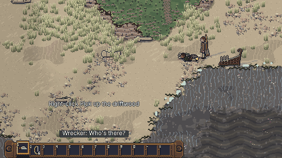
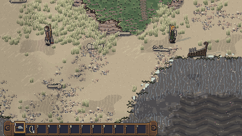
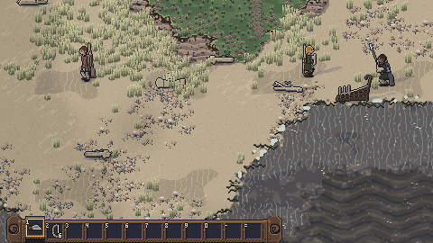
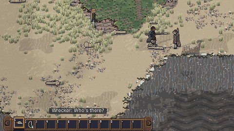
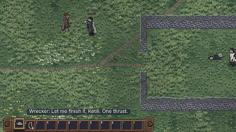
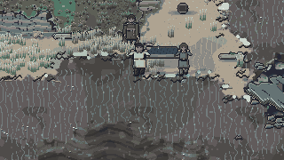

# THE USER'S THIRD PLAYTEST: the combined report, before the Build 1 gate

In the Book 2 section 23 format: one heading per report field. This is the combined report for the
user's third playtest of Chapter 1 (decisions DG-1 to DG-94 in `docs/decision-log.md`, section
"2026-11-13, The user's third playtest"), a third change request after the Build 1 gate and before
Stage 13 (DG-1). It was folded into the books (DG-1 to DG-29), built in three parts with their own
reports, and closed by a final integration pass:

- **The combat** (requests 1 to 5, the sneak hint and the talk at the fold; DG-2 to DG-11, DG-25,
  DG-26 folded, DG-30 to DG-49 built): finish or let go with the SPARED fate, the early combat
  prompts, the two teaching foes (Svart, beaten only by a parry; Ketill, whose red blow must be
  dodged), first-sight warnings and taunts, the heal prompt, the sneak hint and the talk at the fold:
  [playtest-3-combat.md](playtest-3-combat.md).
- **The story** (requests 6 to 8; DG-12 to DG-14 folded, DG-50 to DG-67 built): Hild points to the
  broch, the shelter in three stages over two days, Thorkel's body taken by the sea in sight:
  [playtest-3-story.md](playtest-3-story.md).
- **The interface** (requests 9 to 12; DG-15 to DG-21 folded, DG-70 to DG-89 built): the pause menu
  with three save slots, the autosave and reset to the start of the day, settings, controls and
  fullscreen, the intro's skip, the stuck spot fixed by a rule and walked by the edge-walk test, and
  the developer menu: [playtest-3-interface.md](playtest-3-interface.md).
- **The final pass** (DG-90 to DG-94): the shelter finished on day 2, the chapter's timing, the
  frame budget, golden save 11, the full checks, the gate's captures and this report.

**The Build 1 gate now covers the third playtest** (see [stage-12.md](stage-12.md)): the user
playtests Chapter 1 as it now plays, and Stage 13 waits for the user.

## Implemented
**Combat, story and interface**: as their reports say (linked above). In short: a beaten foe (downed,
begging, or reeling at or below 30%) can be finished with one quick blow by holding V, or let go with
a shout on G, writing SPARED with a hidden fate (favour, ambush or gone) played on the island and
scheduled for later; short input prompts at the right edge in the first three fights; Svart turns
every blow but a parry's riposte, Ketill strikes only the unblockable red blow and is hurt only in
its recovery; every Chapter 1 enemy speaks first, a warning or a taunt, then pauses; the heal prompt
and the sneak hint; the scavengers talk at the fold until they notice the steerer; Hild points to
the old tower; the shelter goes up as the frame and the sail on day 1 and is finished on day 2;
Thorkel is borne down on a bier and taken by the waves; Escape opens the pause menu (it holds time
only when no enemy is aware), with three slots and the autosave card, each with day, time, place and
a screenshot, reset to the start of the day, settings, controls and fullscreen; the intro can be
skipped once seen; no collision shape traps anyone (the stuck spot was the tide closing under the
steerer on the flats); the developer menu on F3 with `?dev`. World state version 13.

**The final pass** (this session):
- **The shelter finished on day 2** (DG-90). The story build finished it on day 3 in the scripted
  run, because Hild, its only builder until Runa came home, fished first whenever the stores did
  not hold the next day's food (DG-56), and at her wound's pace she does about a third of a
  worker-day in a day. Two changes, no new number, both from the books: **everyone home joins the
  finishing as they come** (Book 10 already said "others join as they come home"; Oddi and Bran now
  take it up first from the camp's work, as Hild does, with two more builder spots in the court so
  no two stand on one), and **Hild reckons the ship's stores on the mast** (Book 10 mastStores)
  towards tomorrow's food while they are still lashed there or in the shallows; with nothing at all
  in the stores for the evening meal she fishes first. It is now finished at 15:47 on day 2 in the
  chapter run, and before the work day ends when played without a hand lent, at a player's pace or
  begun two hours late by the slow ways without the stores; nobody goes a day without eating on day 2
  or 3. Book 10 shelterFinish's notes say so; `content/balance.json` regenerated.
- **The chapter's timing** (DG-91, DG-92): the cause found beat by beat and the scripted players'
  faults fixed (see **Timing**). The chapter run's player now lends the one Build action Hild asks
  for on the second morning (in place of four) and sleeps through a night with nothing to do but
  wait.
- **The frame budget** (DG-93): the day-start save's screenshot stalled the first frame of play;
  it is now read back from the GPU without waiting (see **Frame budget**).
- **Golden save 11** regenerated at schema 13 (DG-94); a household fighter's fight mind is reset
  when a fight ends (Bran carried a RETREAT mind from the fold to the chapter's end).
- **Tests**: `tests/scenario/shelterDay2.test.ts` (new, 2 tests); two tests in
  `tests/unit/pt3story.test.ts` (Hild's reckoning; everyone joining); the chapter run's telemetry
  tests in `tests/scenario/launch.test.ts` now check the shelter is finished on day 2;
  `tests/unit/saves.test.ts` golden 11 at schema 13; `tests/unit/workLoops.test.ts` sets the ship's
  stores brought up so Hild keeps to her nets in its fishing scene (the test is about the loop, and
  with the stores still on the mast she now goes to build once she has landed a fish).

## GIFs
Captured from the real game by the combat and story builds (`npm run capture -- playtest-3-combat`,
`npm run capture -- playtest-3-story`), each at 1x and under 4 MB.

**The finisher** (`docs/art/playtest-3/combat/finisher.gif`, 1.09 MB): Svart reeling at the stern,
the choice at the right edge, V held, the seax's standing finisher: one blow, his fall.

**The spare** (`spare.gif`, 1.55 MB): Svart downed, G: the steerer's shout, his reply, the spear
dropped, his run.

**An enemy's warning** (`warning.gif`, 1.85 MB): Conn alone at the stern at dusk warns on first
sight, and the pause before any attack.

**An enemy's taunt** (`taunt.gif`, 0.99 MB): Svart and Conn together: the taunt on first sight, and
the shorter pause.

**The parry-only foe** (`parry-only.gif`, 2.78 MB): three blows turned by Svart's guard, the parry
prompt, his blow parried and the riposte, his line.

**The dodge-only foe** (`dodge-only.gif`, 1.70 MB): Ketill at the fold, the red glint and the
prompt, Bran's guidance, two red blows dodged and his recovery struck.

**Thorkel's body taken by the sea** (`docs/art/playtest-3/story/thorkel-taken.gif`, 2.87 MB): the
bier carried down the flats at low water, the three waves, the backwash, the drift, the sink in its
ring of foam, Hild's last line.

Also in the story folder: the shelter's three stages (`shelter-stages.gif`, 1.67 MB).

## Tests
- `npm run lint`: **clean.** ESLint, Prettier, content lint (1628 strings, 532 registered IDs) and
  art lint (149 sheets, 69,257 frames, 0 placeholders).
- `npm run build`: **builds** (the usual large-chunk warning only).
- `npm test`: see the final figures under **Test counts** below. In this pass the first full run
  found 1 failure (`workLoops.test.ts`, fixed as above) and its budget pass, run straight after the
  suite on a machine still loaded, failed once (`standard.test.ts` "builds a strand frame within the
  Book 2 budget"); run alone it passed three times of three.
- `npm run test:browser -- --project=chromium` (one full run, 8.8 min, fully parallel): **94 passed,
  1 failed**: `storm.spec.ts`'s frame budget read 5.58 ms in the cold open under the full run's
  load (before this pass the parts measured 6.06 and 9.78 ms). Run again alone with
  `standard.spec.ts` (`--workers=1`): **4 passed**, the cold open at 3.13 ms and the strand at
  3.83 ms. No threshold, standard or budget was changed.
- WebKit was not run here: its browser cannot be downloaded in this environment. CI runs Chromium
  and WebKit, and both block publishing. Firefox is not tested (BR-9).
- **CI on GitHub, run 43460340385 (commit ab99f7d): WebKit passed; Chromium 93 of 95** — the two
  frame-budget measures read 6.05 to 7.18 ms beside other browsers on the two-core runner (2.5's
  published build failed the same two checks the same way). They are now timed alone (DG-95): 4.55 ms
  (strand) and 2.77 ms (cold open) here, limit unchanged. **The CI run for the DG-95 commit: see
  the end of this report.**
- No probe or scratch tests are left in the tree.

### Test counts
- `npm test` (final run, after every change of this pass): **57 files, 913 tests: 912 passed, 1
  skipped, 0 failed**; then the frame-budget pass timed alone (`OE_BUDGET=1`): 1 passed (its other 7
  skipped by design). The skipped test in the main run is that budget test.
- Each stage's tests run again (below): 72, 96, 226, 62, 37 and 117 passed, none failed.

### The tests the user asked for (all pass)

| Asked for | File | Test |
|---|---|---|
| Pause restores the right state | `tests/unit/pt3ui.test.ts`; `tests/browser/pt3ui.spec.ts` | "pause stops the simulation, except when an enemy is aware (asked; DG-15)": "Escape, P and the pad’s Start open it; under the safe rule no tick runs, of any length" and the rest of that block; browser "Escape pauses the world under the safe rule; the menu is drawn over the dimmed frame" |
| Reset to the start of the day restores the right state | `tests/unit/pt3ui.test.ts`; `tests/browser/pt3ui.spec.ts` | "reset to the start of this day restores the right state (asked; DG-17)": "on day 1 (the waking in the surf) and on a later day, after a sleep, keeping settings and every slot", "after a fight: the day-start is the morning’s, whatever the fight changed"; browser "reset to the start of this day goes back to the waking" |
| Save slots round-trip | `tests/unit/pt3ui.test.ts`; `tests/browser/pt3ui.spec.ts` | "save slots round-trip (asked; Book 2 section 20; DG-16)": "each of the three manual slots loads back the same world, with its day, time, place and screenshot", "the autosave slot shows the newest autosave or checkpoint and cannot be saved to"; browser "a save goes to a slot with its day, time, place and screenshot, and loads back" |
| Spared enemies are recorded | `tests/unit/pt3combat.test.ts`; `tests/browser/pt3combat.spec.ts` | "spared enemies are recorded (asked; decisions DG-4 to DG-6)": "letting go a reeling / downed / begging foe writes SPARED, a record with its fate, drops the weapon, and the foe leaves without rejoining", "the fates’ shares over 2,000 seeded spares match Book 10’s odds within 3 points, under each condition", "SPARED is read by each culture’s row", "the scheduler: a Chapter 1 spare waits for the launch..."; browser "a beaten foe: the choice at the right edge; G lets go, with the shout, the reply and the run" |
| The two teaching enemies can only be beaten their intended way | `tests/unit/pt3combat.test.ts`; `tests/browser/pt3combat.spec.ts` | "the two teaching foes are beatable only their intended way (asked; decision DG-9)": for Svart and for Ketill, "<foe>: "<way>" for 5 minutes leaves him at full vitality" (14 ways), "a player that parries beats Svart, on 10 seeds", "a player that dodges the red blow and strikes in its recovery beats Ketill, on 10 seeds"; browser "Svart turns a blow outside his opening; the parry prompt shows at his telegraph" |
| Every tutorial enemy speaks before attacking | `tests/unit/pt3combat.test.ts`; `tests/browser/pt3combat.spec.ts` | "every tutorial enemy speaks before attacking (asked; decision DG-8)": "at the dusk, <approach>" (walking or running from the west, down the bank, sneaking, from the east), "<band>, met from the <side>" (the fold, Seal Cave, one alone), "a warning when alone or outnumbered, a taunt in a group; no line follows itself or comes again before its pool is used through"; browser "the scavengers at the stern speak before any attack (first sight)" |
| The edge-walk no-trap test | `tests/unit/noTrap.test.ts` | "No trap: the edge-walk test (Book 10 section 25; decision DG-20)": one test a zone, "<zone>: from every edge of every collision shape, at every tide, the steerer gets clear", and "no gap between collision shapes narrower than the footprint + the margin exists"; with the user's spot: "reproduced: on the flats at the seaward foot as the tide closes, every step was refused", "played through the simulation: walked onto the flats at dusk, held there to 20:41, then walked off" |
| Rescued people reach camp and sleep under the shelter | `tests/scenario/rescued.test.ts`; `tests/unit/opening2.test.ts`; `tests/browser/rescued.spec.ts` | "everyone rescued walks to camp, works, eats, sleeps under the shelter and talks (DE-22, DE-82)" (36 runs of Hild, Oddi, Bran and Runa); "Hild, Oddi, Bran and Runa reach the camp and sleep under the shelter, two nights running"; browser "Oddi set down on his strand is rescued there: he limps home to the camp and talks" |
| The shelter finished by the end of day 2 (this pass) | `tests/scenario/shelterDay2.test.ts`; `tests/scenario/launch.test.ts`; `tests/unit/pt3story.test.ts` | "the shelter is finished on day 2 in normal play (DG-90, DG-91)": "without a hand lent: the searches at a player’s pace, the bow and the stores, and everyone fed", "the slow ways and without the stores: the early morning elsewhere, Oddi home first, the cliff path, the sneak, the bow left"; the chapter run: "records the chapter’s time, the first fight and every beat..." and "counts the time menus hold the game..." (both check day 2); "Hild reckons the ship’s stores on the mast towards tomorrow’s food, and fishes with nothing in the stores", "everyone home joins the finishing as they come, and goes back to their own work once it is done" |

**Golden saves** (`tests/unit/saves.test.ts`, 30 tests): goldens 1 to 10 load through the
migration chain to version 13 and play on; golden 11 "loads, matches its hash and holds Chapter 1
as the third playtest plays it, ended" and "is reproduced exactly by its scenario".

## Stages 7 to 12 redone
Each stage's tests were run again in this pass, after every change (unit and scenario tests by
stage, one run each on an idle machine; then the stage's browser specs in the full Chromium run).
Every one passes.

| Stage | Unit and scenario tests run again | Browser specs |
|---|---|---|
| 7 | 72 passed (`home`, `driftwood`, `homeAudio`, `workLoops`, `pt3story`, the new `shelterDay2` scenario) | `stage07.spec.ts`, `pt3story.spec.ts` passed |
| 8 | 96 passed (`people`, `synth`, `audioCoverage`, the rescue scenario `rescued`) | `stage08.spec.ts`, `rescued.spec.ts` passed |
| 9 | 226 passed (`combat25`, `combat2`, `combat`, `missiles`, `water`, `pt3combat`) | `stage09.spec.ts`, `combat2.spec.ts`, `combat25.spec.ts`, `pt3combat.spec.ts` passed |
| 10 | 62 passed (`searches` scenario, `opening2`, `omen`, reachability `southern`, `noTrap`) | `stage10.spec.ts`, `opening2.spec.ts`, `opening.spec.ts` passed |
| 11 | 37 passed (`repairs` scenario, `ship`, `shipArt`) | `stage11.spec.ts` passed |
| 12 | 117 passed (`launch` scenario and unit, `saves`, `text25`, `storm25`, `pt3ui`) | `stage12.spec.ts`, `text25.spec.ts`, `pt3ui.spec.ts`, `standard.spec.ts` passed; `storm.spec.ts` passed alone (budget missed under the full run's load, above) |

### Stage 7: day and night, shelter and first tasks
**What the third playtest changed:** the shelter in three stages over two days with Hild's word at
each (DG-12, DG-50 to DG-54, DG-61, DG-62); this pass: finished on day 2 by the household (DG-90).
**Its checks now:** 1 and 2 (the day, sleep after 18:00, the morning report) hold (`home.test.ts`;
`stage07.spec.ts`). 3 and 4 (tasks and their loops) hold; the frame and the sail are each one plain
action, the finishing building work. 5 (the stamina bar) holds. 6 (the standard): the camp 82.6% in
the gate capture (2.5: 83.2%); the finished shelter 83.5% by day and 91.5% at night (the story
build's captures). 7 (audio): the frame's sound, the sail's haul and fill render under the ceiling.

### Stage 8: crew agents, schedules and conversation
**What changed:** Hild's lead to the broch (DG-13); the finishing as the first job of everyone home
(DG-90), each at their own spot; the rites' carrier leaves the fold's walk (DG-67).
**Its checks now:** 1 (Hild useful at once and always doing something) holds (`stage08.spec.ts`). 2
and 3 (topics, deltas, bands) hold (`people.test.ts`). The rescue scenario test runs 36 rescues
(`rescued.test.ts`): everyone reaches the camp, sleeps under the lean-to the first night and under
the finished shelter's roof once built, eats and talks. 4 and 5: unchanged.

### Stage 9: combat
**What changed:** finish or let go, the prompts, the teaching foes, first sight, the heal prompt,
the sneak hint (DG-2 to DG-11, DG-25, DG-30 to DG-49); this pass: household fight minds at rest after
a fight (DG-94).
**Its checks now:** 1 (frame data matches Book 10, every tell at least 6 ticks before its active
frames) holds, the finishers' frame data by weapon and variant included (`pt3combat.test.ts`). 2
(parry and charge) holds; the older mechanics' tests fight the scavengers as plain outlaws (DG-48).
3 (missiles) holds; a missile Svart or Ketill turns falls at his feet (DG-43). 4 (the steerer's
death; the downed never die on a timer) holds. 5 (the standard): the dusk at the stern 88.9% in the
gate capture (2.5: 89.1%); the six combat clips. 6 (audio): the finishers, the spare, the guard
turn and the red scrape render under the ceiling, none captioned (DF-80).

### Stage 10: the three searches and the southern island
**What changed:** the talk at the fold, Ketill's red blow at the fold or the cave, the spared
scavengers' fates on the island (DG-26, DG-9, DG-41); the stuck spot fixed by rule (DG-70 to DG-74).
**Its checks now:** 1 (two viable approaches a search) holds for all six (`searches.test.ts`). 2
(reachability at high and low tide) holds (`southern.test.ts`), and the edge-walk test finds no trap
in any zone at any tide (`noTrap.test.ts`). 3 (the Hag's Seat) holds (`omen.test.ts`). 4 (the
standard): no southern view changed in this pass. 5 (audio): the fold's murmur renders at 0.35.

### Stage 11: boat repairs and the first fitting
**What changed:** Runa turns to the boat a day sooner now the shelter is finished on day 2 (DG-90).
**Its checks now:** 1 (each repair visibly changes the boat) holds (`shipArt.test.ts`;
`stage11.spec.ts`). 2 (`deriveStats`) holds (`ship.test.ts`). 3 (no task asks for a large count)
holds (`repairs.test.ts`, the Seal Cave theft scenarios included). 4 (the standard): the launch
views below. 5 (audio): unchanged.

### Stage 12: the launch and the Build 1 gate
**What changed:** Thorkel taken by the sea (DG-14, DG-55 to DG-60); the pause menu, slots, reset,
the intro's skip and the developer menu (DG-15 to DG-21, DG-75 to DG-89); golden save 11 at schema 13
(DG-94).
**Its checks now:** see **Gate checks**.

## Gate checks
1. **Chapter 1 takes 45 to 60 minutes for a new player, with combat inside 25 minutes (by
   telemetry): MEASURED, NOT PROVEN.** 51:53 at a human pace, 52:33 at the bot's; the first fight
   at 17:00 to 17:44 (the fold), the dusk fight on offer from about 10 minutes. See **Timing**.
2. **User playtest: READY** for the user's playtest of the third playtest's build
   (`docs/playtest/build-1.md` stands; the new controls are in the pause menu's Controls page).
3. **Art lint clean for every Build 1 asset, no placeholders: PASS.** 149 sheets, 69,257 frames,
   0 placeholders.
4. **The Book 7 section 14 standard: PASS** for every in-world view of the gate capture (82.6% to
   93.9% against 80%; see **Art check**), the strand in the browser (96.2% to 96.4%) and the cold
   open (97.2% to 97.6%).
5. **The browsers block publishing:** Chromium passed here (94 of 95 in the full run, the 95th, the
   cold open's budget under load, passed alone); WebKit runs in CI and `deploy` needs both. **CI
   results: see the run for this commit.**
6. **Audio: PASS.** Every new sound of the three parts renders under the ceiling (their reports;
   see **Balance**). This pass adds no sound. I cannot hear the renders: the user should listen in
   the sound test.

## Timing
Measured by the telemetry, the scripted player playing the whole chapter through the simulation's
commands (`node src/tools/play/chapterRun.ts chapter-1 [human]`, seed chapter-1; the bot route is
golden save 11). The clock starts at the waking.

**The cause of the 66:59** (DG-92), beat by beat against 2.5 (16f3720, built in a clean worktree):

| Mark (human pace) | 2.5 | The three parts (2df876f) | This pass |
|---|---|---|---|
| the chest at the camp | 1:19 (07:35) | 1:25 (07:42) | 1:25 (07:42) |
| the lean-to up | 3:20 (10:50) | 3:30 (11:02) | 3:30 (11:02) |
| the first night | 11:25 | 11:25 | 11:25 |
| Oddi | 13:20 (day 2 07:59) | 13:32 (10:13) | 13:24 (08:34) |
| Runa | 15:24 (10:28) | 15:36 (12:42) | 15:28 (11:03) |
| the first fight (the fold) | 17:39 (13:09) | 17:50 (15:23) | 17:44 (13:45) |
| Bran | 18:23 (14:02) | 18:47 (16:31) | 18:40 (14:53) |
| the bow | 19:55 (15:54) | 20:24 (18:27) | 20:17 (16:49) |
| the stores | 21:07 (17:19) | 21:34 (**19:51**) | 21:27 (18:13) |
| the shelter finished | (S1 not tracked) | 32:25 (day 3 14:35) | **19:25 (day 2 15:47)** |
| the hull | 49:05 (day 5) | 59:03 (day 5 16:26) | 43:49 (day 4 16:46) |
| the oar | 49:41 (day 5) | 60:08 (day 6) | 44:52 (day 5) |
| the fitting | 50:49 (day 6 10:15) | 60:49 (day 6 16:15) | 45:32 (day 5 16:02) |
| the rites | 59:29 (day 6) | 64:51 (day 6) | 49:46 (day 5) |
| the launch | 60:55 | 66:20 | 51:15 |
| **the chapter's end** | **61:33** | **66:59** | **51:53** (2:35 held by menus) |

The real minutes to the stores barely moved (+27 s: the tower's line before the chest's, the frame
as a second action, the fold's first-sight pause and teaching foes). What moved was **the game
clock on day 2: 2.5 game hours later**, two of them the bot's four Build actions on the second
morning (DG-66) and about 20 minutes the fold's fight. So the stores came home at 19:51, **after the
evening's low water** (16:30 to 19:30 on days 1 to 3), and the rigging, which is cut on the
skerry at low water, waited a whole day for the next, with the bot standing awake through it; the
oar and the boat followed a day late, and the chapter ended on day 6. The other suspects cost
seconds: the first-sight pauses (1.5 to 2.5 s each), stepClear's waist-deep pace (only for someone
caught by the flood), the day-start saves (none of the simulation's time).

**What was fixed** (all in the scripted players; nothing in the game was padded or cut):
- the chapter run's player lends the one Build action Hild asks for, not four (DG-91): with the
  household finishing the shelter (DG-90) the steerer's hand is a bonus;
- a walk that stalls is planned again (the tide closing on a path over the flats held the bot
  pressing for 400 s), `waitUntil` no longer waits for ever for a minute a night skipped, a load set
  down on the closing flats is fetched at the next low water (DG-92);
- the chapter run's player sleeps through a night with nothing to do but wait, as a player does
  (DG-92). 2.5 with the same scripted players: 62:19 (it launches on day 6, like 2.5 as reported).

**Stated honestly against Book 10** (45 to 60 minutes):
- **51:53 at a human pace and 52:33 at the bot's: inside the range** (seeds chapter-2, chapter-3 and
  golden: 51:04). It is shorter than 2.5's 61:33 by a game day: the shelter finished on day 2 frees
  Runa for the boat a day sooner, and the boat is fitted and launched on day 5.
- **It swings by a game day on one thing**: whether the stores come home before the second
  evening's low water. With the bot's four Build actions the same build takes 70:15; without any,
  55:44. A new player who spends the second morning at the shelter, or who is slow to the bow, will
  wait a day for the rigging's low water; a player who works the boat or explores meanwhile fills it.
  The bots walk straight to every goal and never search, which a new player does; my estimate for a
  new player is about 50 to 70 minutes.
- **The first minutes** are all inside their targets. **The bow** at 19:33 (bot) and 20:17 (human),
  inside bowBy 20 to 30 at the human pace and 27 s early at the bot's. **Combat inside 25 minutes**:
  the fold at 17:00 to 17:44.

## Frame budget
Measured on an idle machine (no other process doing heavy work, the load under 1.5, one Chromium,
no tests running), the production builds of 2.5 (16f3720, a clean worktree with `node_modules`
linked), of 2df876f and of this pass, served by `vite preview` and read as the specs read them
(`data-frame-ms`, the script's share of a frame, smoothed), three rounds each, a fresh browser for
every reading:

| Reading (median of 3) | 2.5 | 2df876f | This pass | Budget |
|---|---|---|---|---|
| The cold open, 7 s in (as `storm.spec.ts`) | 2.79 ms | 3.96 ms | 2.82 ms | 5.5 ms |
| Wreck Strand, 2.5 s in (as `standard.spec.ts`) | 5.76 ms | 9.43 ms | 5.98 ms | 5.5 ms |
| Wreck Strand, 5 s in | 4.25 ms | 5.34 ms | 4.20 ms | |
| Wreck Strand, settled (15 to 20 s) | about 2.9 ms | about 3.1 ms | | |
| The first frame of play | 215 ms | 607 ms | 274 ms | |

**Yes, the third playtest made it slower, and only at the start.** Settled, the two builds are
within 0.2 ms of each other. The specs read a smoothed figure (0.05 of each frame) at about 9 frames
a second in Chromium's software renderer, so the first frame still weighs several milliseconds when
they read. That frame took 607 ms (2.5: 215) because the waking writes the autosave and the new
day-start save (DG-81), and their screenshot (DG-80) was read from the next frame with a plain
`readPixels`, which waits for every atlas upload and shader compile queued before it (a profile of
the first frame: 427 ms in `readLogicalFrame`). **Fix** (DG-93): `FrameReadback`
(`src/scenes/pauseMenuView.ts`) queues the read into a pixel buffer behind the frame and takes it
with a fence a frame or more later; the PNG is made after that frame, as before. The new canvases,
the menu, the developer menu (absent without `?dev`) and the red glint sheets cost nothing
measurable once running; the first frame's remaining 60 ms over 2.5 is the larger people atlases
(the finishers' frames). The strand's 2.5 s reading is over 5.5 on this machine for 2.5 too (5.76);
the specs passed here run alone (3.83 and 3.13 ms) and in the full run the strand passed (4.30 ms)
and the cold open read 5.58 ms under load. The budget is unchanged.

## Art check
Captures in `docs/art/captures/stage-12/` (`npm run capture -- stage-12`, run in this pass; its
README lists every file). The capture rewrote three files of `docs/art/mockups/stage-12/` again;
they were restored from c7ecdb6 afterwards, so `docs/art/mockups` and `docs/art/stage-06-rework`
match c7ecdb6 (no tracked change, no untracked file from this pass; the gitignored
`docs/art/stage-06-rework/.work/` cache from 11 November is still there, see **Known issues**).

**Motion with the camera still** (Book 7 section 14, 80% of cells), every in-world view:

| View | Moving cells (2.5) |
|---|---|
| Wreck Strand where the steerer gets up (`still`) | 93.9% (94.1%) |
| The boat ready on its skids (`launch-ready`) | 88.9% (88.9%) |
| The heave and the run down the skids (`launch-heave`) | 91.5% (91.7%) |
| Afloat under the mark, rowing (`launch-sail`) | 93.1% (93.1%) |
| The camp with the sail raised, the fire lit (`camp-sail`) | 82.6% (83.2%) |
| The first dusk at the stern, Svart and Conn (`dusk-stern`) | 88.9% (89.1%) |
| The strand in `standard.spec.ts` (with reduced motion and low detail) | 96.2% to 96.4% (62.3% to 62.7%, threshold 50%) |
| The cold open in `storm.spec.ts` | 97.2% to 97.6% |
| The finished shelter by day / under its roof at night (the story build) | 83.5% / 91.5% |
| The sea map (a screen, for the record) | 72.9% |
| Book 7 threshold | 80% |

Every in-world view meets the threshold; the lowest is still the camp. The 10-second clip is
10.0 s. **GIF sizes**: 0.99 to 2.87 MB, every one under 4 MB.

**Compared with `docs/art/reference/`** (`wreck-strand-target.png`, `kelda-summer-target.png`,
`target-walk.mp4`): the strand's shingle, ripples, wrack, dune grass, foam line and moving sea match
the reference as at 2.5; the dusk view keeps its grass in the wind and the surf with the scavengers
at the stern (`dusk-stern@2x.png`, looked at); the camp view shows the broch court with the lean-to
and drying line, the fire's smoke and the sheep beyond (`camp-sail@2x.png`, looked at). The new
art of the three parts (finishers, the red glint, the guard turn, the frame, the bier, the menu)
keeps the reference's outline weight, three-step shading and palette (their reports). This pass
adds no art: the two new builder spots use the residents' existing build loop.

## Balance
- Every number is read from `content/balance.json` (Book 10 revision 2.7). This pass adds no row:
  the shelter's finishing uses Book 10's mastStores (4 rd), the Buildings row's worker-day and the
  consumption row; shelterFinish's notes now say who joins and how Hild reckons (DG-90);
  `npm run balance` regenerated the file.
- **Listening back**: this pass adds no sound. The three parts rendered theirs with
  `npm run audio:render` (peaks, linear; the ceiling is about 0.89): the finisher's thrust 0.394,
  chop 0.812, crushing blow 0.559; the let-go 0.176; the guard turn 0.214 (shaft) and 0.595
  (shield); the red scrape 0.420; the frame 0.246; the body taken 0.351; the sinking 0.299; the
  lament's sea ending 0.454; the menu's click 0.096 and its opening knock 0.125. None clips. Measured,
  not heard (no speakers here).

## Deviations
DG-1 to DG-94 in `docs/decision-log.md`. None departs from Book 1's intent. This pass's are DG-90
(the shelter finished on day 2 by the household), DG-91 (one Build action by the chapter run's
player), DG-92 (the timing's cause and the scripted players' fixes), DG-93 (the frame budget's
first-frame stall) and DG-94 (golden save 11 at schema 13; fight minds at rest after a fight).

## Known issues
- **The chapter's length swings by a game day** on whether the stores come home before the second
  evening's low water (51:53 against 70:15 with four Build actions on the second morning). Medium;
  the playtest will tell.
- **The shelter's margin**: begun after about 09:00 by every slow way and with no help, the finishing
  runs into the next morning by about half an hour of work (DG-90). Low.
- **The frame budget under load**: in the full parallel run the browser's budget measures read over
  5.5 ms (here 5.58; on CI 6.05 to 7.18, as 2.5's published build did). They are now timed alone
  (DG-95). Alone, the strand reads 3.8 to 6.0 ms across this pass's runs on this machine, so the
  strand is the one closest to its limit; the cold open reads about 2.8 ms.
- **The budget unit test** (`standard.test.ts`) failed once straight after the suite on a loaded
  machine and passed three times alone.
- **The spared remembered after the launch** (Stage 13's hooks), **no `world` stream**, **dropped
  weapons not taken up**, **the heavy generic body's finishers** and **the prompts at the stern's east
  end**: as the combat report says.
- **Pad remapping** on the controls page and **saves from before this build** not listed: as the
  interface report says.
- **`docs/art/stage-06-rework/.work/`** holds 417 gitignored files written on 11 November by the
  Stage 6 rework's tools (not by this pass); left in place, to be removed if the user wants the
  folder bare.
- **WebKit** was not run here (its browser cannot be downloaded in this environment); CI runs it.

## Flagged for the user's review
Every choice from DG-1 onwards that wants the user's look, short and grouped. The earlier lists in
[rework-2.5.md](rework-2.5.md), [rework-2.4.md](rework-2.4.md) and [stage-12.md](stage-12.md) stand
where the third playtest did not replace them.

**Finish or let go**
- A foe is beaten at or below 30% vitality when staggered (a 90-tick reel), downed or begging; hold V
  to finish, G to let go (DG-2); on a pad, Y and A in context while no other foe winds up (DG-2,
  DG-46).
- An enemy knocked down at or below 30% lies downed instead of dying (DG-31); a reel neither finished
  nor let go ends in flight or begging (DG-32).
- The spared fates: favour 35%, ambush 25%, gone 40%, with their modifiers (DG-6); drawn on the
  `encounters` stream, since there is no `world` stream yet (DG-33); Chapter 1's scavengers play
  their fate on the island first (DG-6, DG-41); the road ambush, the favours and the grateful
  survivor after the launch wait for Stage 13 (DG-41).
- A spared foe's weapon lies as loot but cannot be taken up in Chapter 1 (DG-38).
- The unarmed finisher borrows the foe's weapon's frames; finishers with weapons the steerer does
  not carry drawn on the weapon layer; the generic heavy body has no weapon layer (DG-36, DG-37).
- A poise break still interrupts a finisher (DG-35).

**Prompts, the teaching foes and first sight**
- The combat prompts: input prompts only, the first three fights, each retired after three uses,
  at the right edge (DG-7, DG-44, DG-45); the option (first fights, always, off).
- Svart and Ketill as the teaching foes, and Svart turning even a backstab, so the dusk's sneak
  backstab is on Conn (DG-9); a dodged red blow counts as a miss (DG-42); a turned missile falls at
  his feet (DG-43).
- The red glint in the reserved Danger tell accent, the scrape on the tells bus (DG-10).
- First sight: a warning or a taunt, the pauses of 2.5 s and 1.5 s (DG-8, DG-40).
- The heal prompt follows the hit's threshold in a fight (DG-47); Hild's dune-grass cue 2.5 s after
  her dusk aim (DG-30).

**The story**
- The frame drawn as two oars upright at the lean-to's posts and a third as the ridge, not crossed
  shears (DG-51).
- **The shelter finished on day 2 by the household** (DG-90): Oddi and Bran join it as they come
  home; Hild reckons the ship's stores on the mast as tomorrow's food; begun after about 09:00 by
  every slow way and with no help, it is finished the next morning (this pass).
- The finishing's aim after the stores' aim (DG-53); "the finished shelter" read as the S1 shelter
  across the court (DG-12).
- The carry down the flats at low water: the bier at the bearers' pace when the edge is far (DG-57);
  the scene's 18.7 s by Book 10's own steps (DG-58); the turn one way (DG-60).

**The interface**
- The menu does not pause, and does not dim the world, while an enemy is aware (DG-15, DG-76).
- One store of saves for the device; older saves not listed (DG-78).
- Once the intro has been seen, holding the steering keys also skips it (DG-86).
- The menu's opening knock is the click's low variant (DG-88); F3 is the developer menu in developer
  mode, so quick command 3 is on the ring and pad there (DG-22).
- The stuck spot's second form (dry humps ringed by the flood) fixed by the rule, not by changing the
  plans; deep water waded at the waist band's pace (DG-70, DG-71).

**Timing and bookkeeping**
- The chapter at 51:53 at a human pace, after the scripted players' fixes; its one-day swing on the
  second evening's low water (DG-92). The chapter run's player lends one Build action, not four
  (DG-91), and sleeps through a night of waiting (DG-92).
- The autosave screenshots read back without stalling the frame (DG-93).
- Golden save 11 at schema 13 (DG-94).
- The browser's two frame-budget measures timed alone after the parallel run, limit unchanged (DG-95).

## Next stage ready
No. The third playtest's build comes before the Build 1 gate, which now covers it: the user
playtests Chapter 1 as it now plays, and Stage 13 (sea-map travel) waits for the user's word.
