# THE USER'S FOURTH PLAYTEST: the combined report, Stage 12 finished

In the Book 2 section 23 format: one heading per report field. This is the combined report for the
user's fourth playtest of Chapter 1 (decisions DH-1 to DH-166 in `docs/decision-log.md`, section
"2026-11-13, The user's fourth playtest"), twenty-six numbered requests and one added during the
work (the shelter's prompt), together with the user's second request of the day, **a reason for the
first raid**. The books were changed first by each part's builder, then the parts were built, then a
final integration pass brought them together and finished Stage 12:

- **The story and scenes** (requests 1 to 8 and 22, and the shelter's prompt; DH-10 to DH-39).
- **The people** (requests 9 to 14; DH-40 to DH-66): [playtest-4-people.md](playtest-4-people.md).
- **Combat and AI** (requests 16 to 21; DH-70 to DH-80).
- **The world and art** (requests 15 and 23 to 26, and the bed, DH-3; DH-100 to DH-129).
- **A reason for the first raid** (the user's second request; DH-130 to DH-152).
- **The final pass** (DH-160 to DH-166): the save version, the suite green at its causes, the frame
  budget, the chapter's length, the stores' carry-home nudge, the carried-load draw fix, the
  playtest script, the walkthrough and this report.

**Stage 12 is finished**, and the Build 1 gate covers the fourth playtest: the user playtests
Chapter 1 as it now plays (`docs/playtest/build-1.md`). Stages 13 to 16 come next (DH-2).

## Implemented

### The story and scenes (DH-10 to DH-39)
- **The shelter's prompt** (DH-4, DH-10, DH-11): its cause was the play view building its own list
  of uses without the opening's (the frame, the sail, the key, the chest); one function,
  `placedUsesHere`, now gives both the simulation and the prompt the same list, and the frame and the
  sail are worked at a marked spot beside the bed, drawn as final art (a driftwood stake and a cord
  over a scratched line; on the second morning a turf spade).
- **The strongbox taken in sight** (DH-12 to DH-18): carrying Oddi, a named scavenger (Conn, or
  whoever of the band is free) breaks from the dune grass in a brief held scene and hauls the box up;
  set Oddi down and run him down and he drops it; if he gets away the silver is lost and remembered
  (Oddi names him; Ketill speaks of it at the fold).
- **Hild on her father** by the facts, never "we never found Father" once he is found; **"Your
  father's rites"** in her talk; **the rites' own music** (stones and sea, generated note data)
  (DH-20 to DH-23).
- **The steerer's word over a body**: three for Thorkel, one for a fallen foe, "Look at" (DH-24 to
  DH-27), with a soft breath and no voice.
- **The broch's quarrel** starts only in view (DH-28 to DH-30); **Runa's reminder** of her tool chest
  (DH-31); **Bran's shouts at the fold** as the blows come (DH-32, DH-33); **"Stand still. Aim at
  the rope"** only where it helps (DH-34, DH-35); **"Nothing that way. The broch is north of here."**
  names a real open way (DH-36).

### The people (DH-40 to DH-66)
- **The bound sit still, and Runa refuses** by her Superstitious trait, until she binds it herself
  or a later day (DH-40 to DH-43).
- **Their own hours** through the steerer's sleep: early risers, Hild late at the fire, the night
  watch by turns (DH-44 to DH-47).
- **Talk among the household**: 18 exchanges, 46 lines, chosen by ties, traits and events (DH-48 to
  DH-52); **nudges** towards the current aim and **"Ask for advice"** (DH-53 to DH-58).
- **Boat work**: six spots round the boat and three seated, never shared; "The boat" tells what it
  needs next; the boat drawn in stages as the work goes on (DH-59 to DH-64).

### Combat and AI (DH-70 to DH-80)
- **The freeze lifting the downed Bran**: his sheets lacked the carried and downed poses; drawn now,
  and every liftable person's frames checked (DH-70).
- **The steerer's death**: a collapse before the screen, the sound draining away (DH-71).
- **Guards hold a post without pacing; pursuers keep together** (DH-72, DH-73); **target choice by
  threat** (DH-74); **a foe let go runs off out of sight** (DH-75).
- **Hitboxes against the drawn frames**: the spear's thrust is a line, weapons facing south and north
  drawn to their real reach (DH-76); the spear attacks a little more often (DH-77).

### The world and art (DH-100 to DH-129)
- **The bed** (DH-3, DH-100 to DH-104): it moved at S1 and was given to a resident; now one place by
  the west wall at both stages, covering its ground, with its own look (a stone kerb, bracken and the
  madder blanket); "too early to sleep" says the hour from Book 10.
- **Sleepers under blankets**, breathing on their own phases (DH-105, DH-106).
- **No internal ID on screen** (DH-110 to DH-114): every name goes through one function; an ID lint
  in `npm run lint` and a runtime guard.
- **Eight finds off the paths** (DH-115 to DH-121), each with its story caption, sound and reward.
- **The broch's interior reworked** (DH-122 to DH-127): a worn floor, the hearth's hot core and a
  lamp's pool, smoke that rises and spreads under the sail, the household's things with a purpose.

### A reason for the first raid (DH-130 to DH-152)
- **Needs felt and spoken from day 1** (DH-131 to DH-135): the ship's meal-sack is real food and the
  morning report counts the grain down with the days to the autumn storms and one thing that ran low;
  need lines in barks; need topics (Hild's stores, Runa's nails, Bran's axe, Oddi's chart).
- **The mainland pointed out** from the Hag's Seat on a clear day (DH-136).
- **The scavengers are Carrick folk** whose skin boat in Seal Cave holds Carrick grain, nails and a
  net to carry home (DH-137, DH-139, DH-146).
- **The Carrick clue in every outcome**: a beaten scavenger asked, a parley, the boat's mark, Oddi's
  chart (DH-138, DH-142).
- **The council at the fire before the launch**, with four intents (quiet, threat, trade-goods,
  force), remembered and shaping Carrick's plan and the household's words there (DH-140 to DH-145).

### The final pass (DH-160 to DH-166)
- **World state version 14**; golden save 11 frozen at 13, golden save 12 at 14 (DH-160).
- **The frame budget**: the broch's cost found (7,645 grass sprites in view) and the plants drawn as
  one exact batch, the sprite passes by instances (DH-161; see **Frame budget**).
- **The suite green at its causes** (DH-162).
- **The council before the rites**, bringing the chapter back inside 60 minutes on every seed
  (DH-163).
- **The stores' carry-home nudges** once the lashing is cut (DH-164).
- **A carried load drawn in front of its carrier in every facing** (the snatch GIF's missing box,
  DH-165).
- `docs/playtest/build-1.md` and `docs/chapter-1-guide.md` describe the game as it now plays.

## GIFs
Captured from the real game by each part, at 1x, each under 3 MB.

### The story and scenes
**The shelter's mark** (`docs/art/playtest-4/story/shelter-mark.gif`, 1.95 MB): the stake and cord
by the bed, Hild's word, the prompt at the spot, the frame raised.

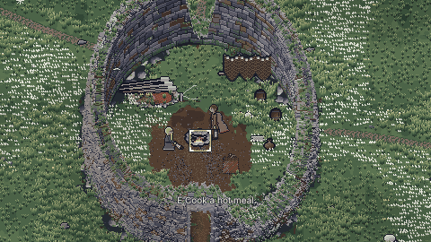

**The strongbox snatched in sight** (`silver-snatch.gif`, 1.35 MB): Conn breaks from the dune grass,
grabs the box and runs. (Captured before DH-165: on one frame running north the box was hidden by
his back; fixed in this pass.)

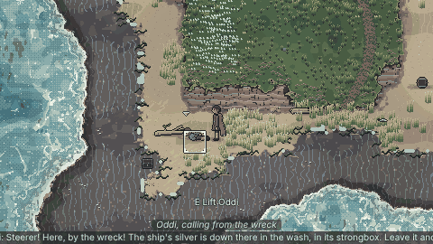

**The steerer's word over Thorkel** (`thorkel-remark.gif`, 0.89 MB).

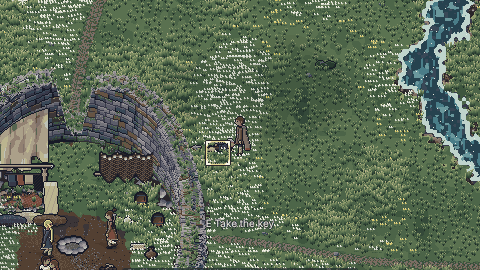

### The people
**Everyone at the boat, spread out** (`docs/art/playtest-4/people/boat-work.gif`, 0.67 MB) and **the
boat changing as the work goes on** (`boat-changes.gif`, 2.18 MB; the stages at 4x in
`boat_stages@4x.png`).

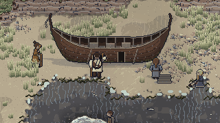
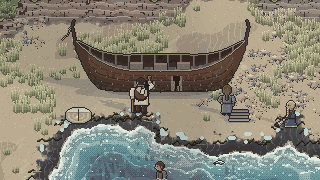
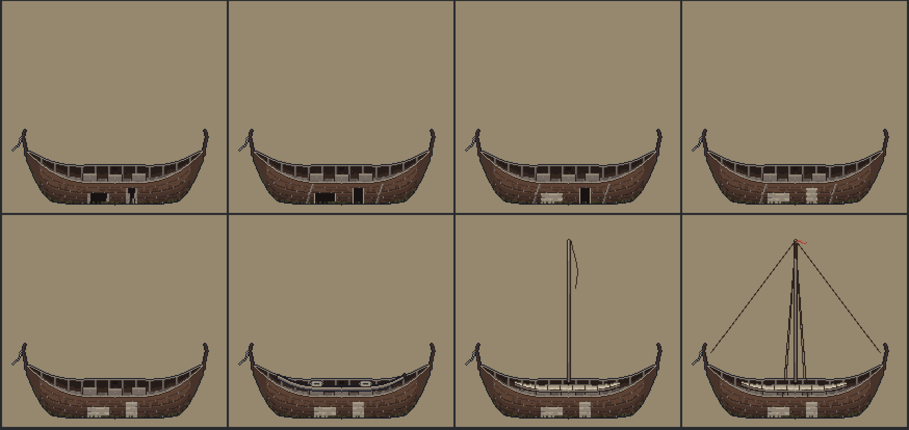

**An evening exchange at the fire** (`exchange.gif`, 2.46 MB) and **Runa refusing, then bound
holding the end** (`refusal.gif`, 2.81 MB).

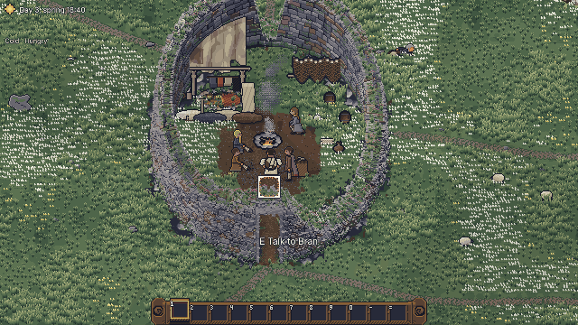
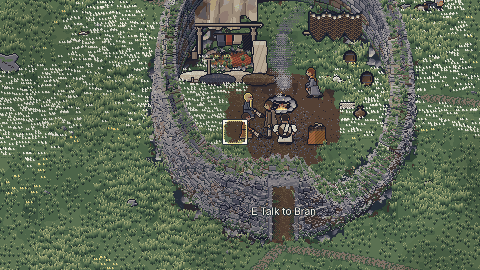

### Combat and AI
**The steerer's death** (`docs/art/playtest-4/combat/death.gif`, 2.00 MB), **a guard back to its
post** (`guard-return.gif`, 2.70 MB), **a spared foe running off out of sight** (`run-off.gif`,
0.99 MB), **the spear's reach** (`spear-reach.gif`, 2.57 MB) and **the band turning on the
striker** (`threat.gif`, 1.99 MB).

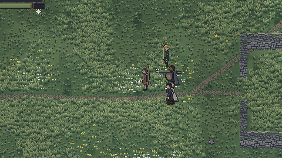
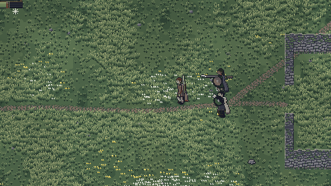
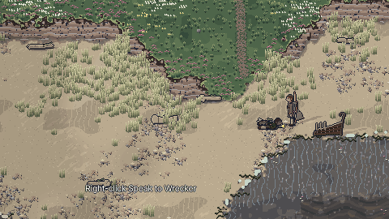
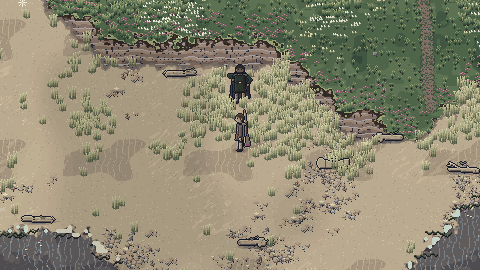
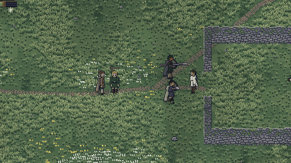

### The world and art
**The broch, before and after** (`docs/art/playtest-4/world/broch-compare.png`: before above,
after below; S0 and S1, day and night), and at night under the finished shelter
(`broch-before.gif`, 0.27 MB; `broch-after.gif`, 0.33 MB).

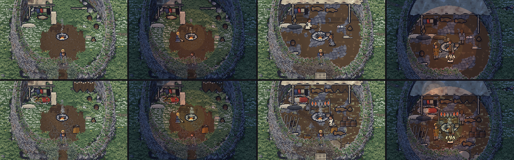
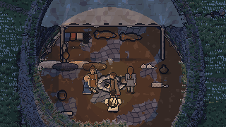
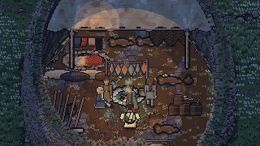

**The bed** by day and night with its prompt (`bed-s1-night@4x.png` and the other `bed-*.png`), **the
steerer asleep** (`steerer-asleep@4x.png`) and **the household asleep under blankets**
(`sleepers.gif`, 0.56 MB; every pose in `sleeper-poses.gif`).

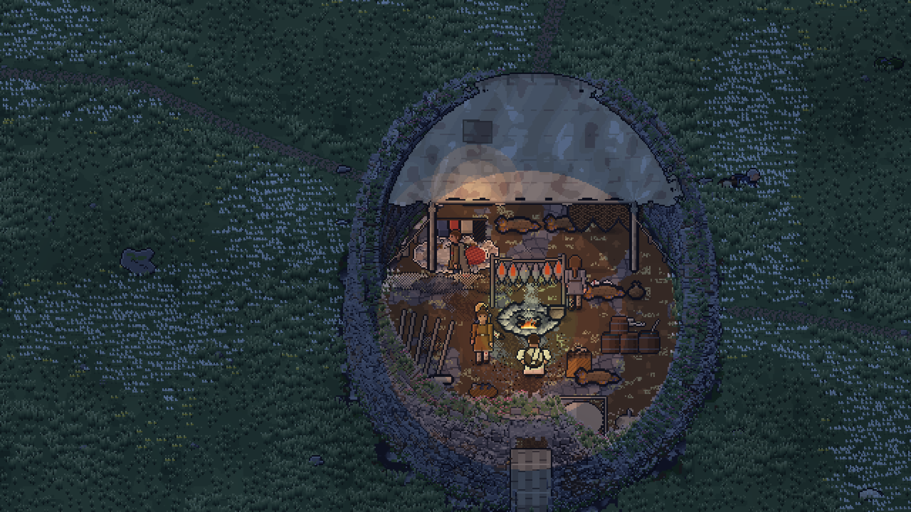
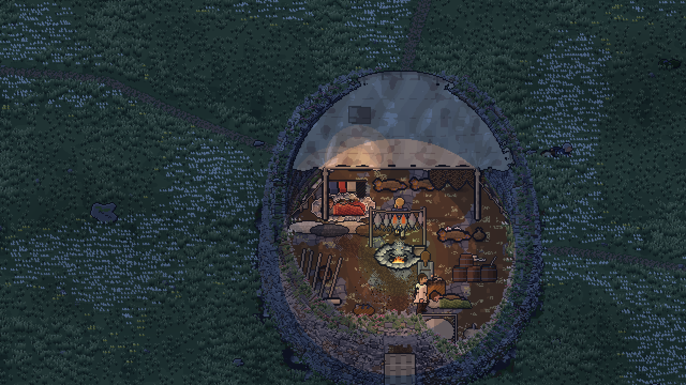
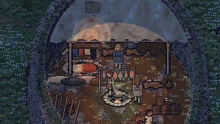
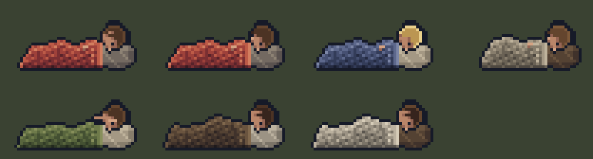

**The eight finds** (`poi-*.png`, at 1x and 4x):

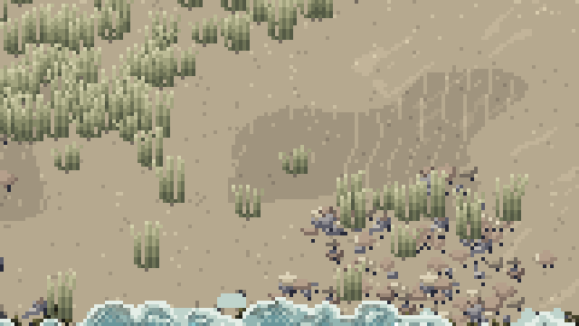
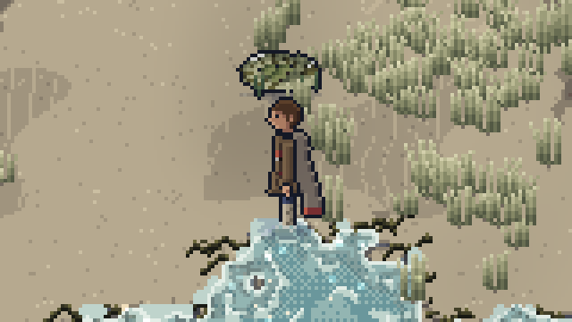
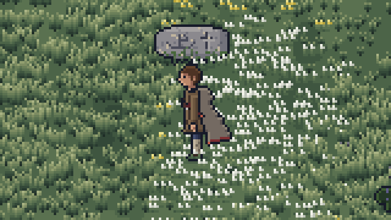
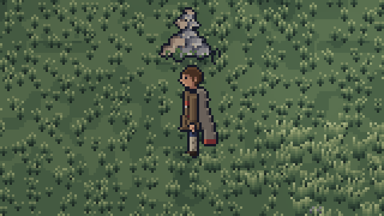
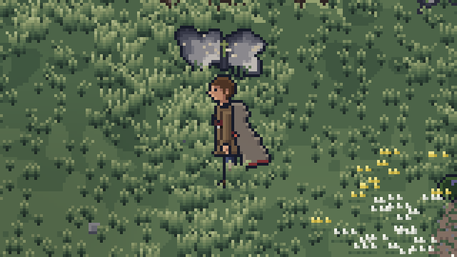
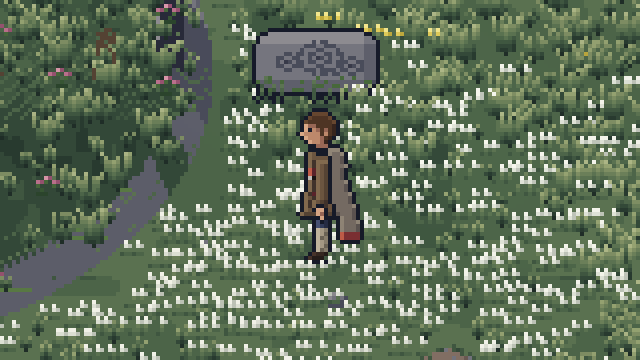
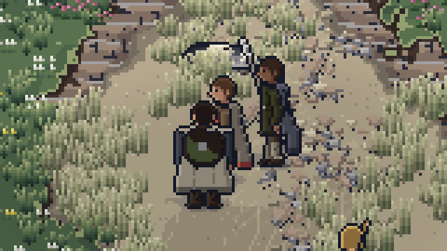
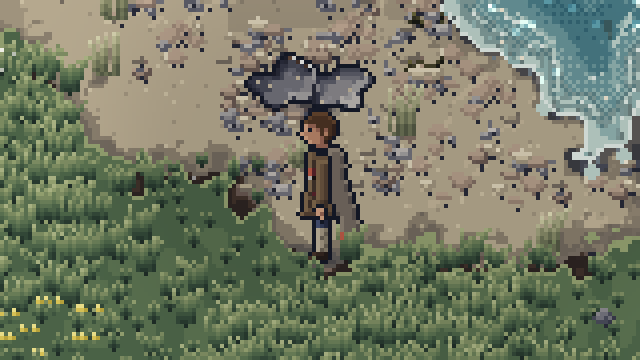

The new sheets at 4x: `sheet-prop_bed_steerer@4x.png`, `sheet-prop_finds@4x.png`,
`sheet-prop_broch_clutter@4x.png`, `sheet-prop_sleepers@4x.png`.

### A reason for the first raid
**The council at the fire** (`docs/art/playtest-4/raid-reason/council.gif`, 2.44 MB), **the
mainland pointed out** (`pointout.gif`, 2.65 MB) and **the skin boat's Carrick goods**
(`skinboat.gif`, 2.65 MB); the redrawn skin boat and the goods at 4x
(`prop_skiff-sheet@4x.png`, `prop_carrick_goods-sheet@4x.png`).

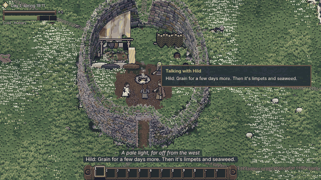
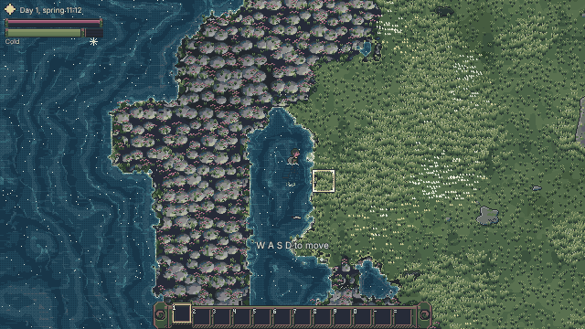
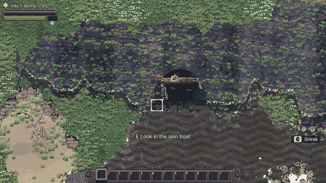
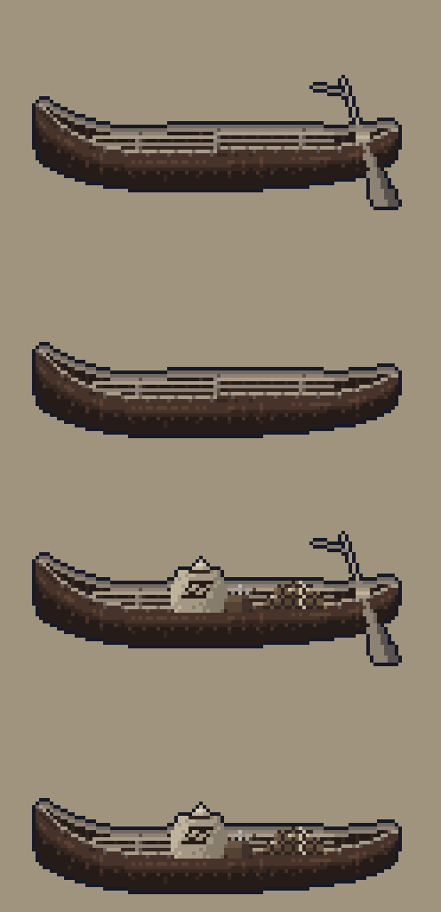
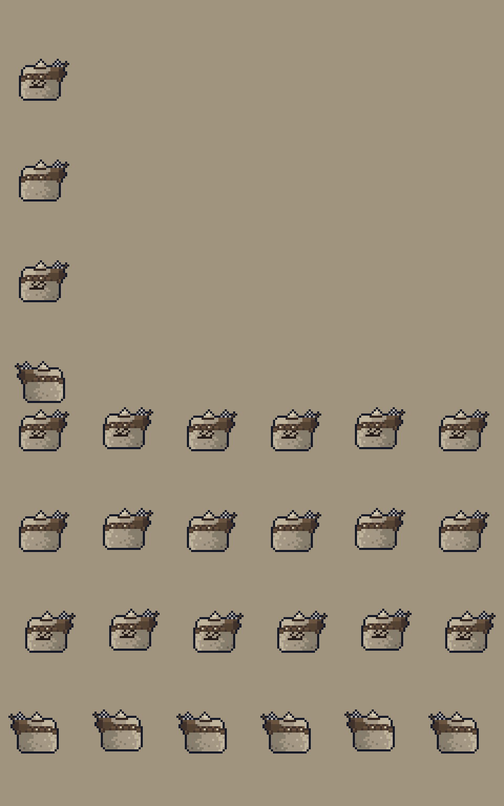

## Tests
- `npm run lint`: **clean.** ESLint, Prettier, content lint (2,050 strings, 546 registered IDs,
  the ID lint included) and art lint (159 sheets, 69,609 frames, 0 placeholders). The ESLint errors
  reported earlier in `playView.ts` and `repairBot.ts` were already gone at f0eec35.
- `npm test` (final run, after every change of this pass): **68 files, 1,106 tests: 1,105 passed,
  1 skipped, 0 failed**; then the frame-budget pass timed alone (`OE_BUDGET=1`): 1 passed (its other 7
  skipped by design). The skipped test in the main run is that budget test.
- **At the start of this pass** the full suite showed **3 failures**, each fixed at its cause
  (DH-162): `idRegistry.test.ts` (the Seal Cave refs quoted Book 4's old line), `art.test.ts` (seven
  new sheets missing from its list of committed sheets; art lint already passed them) and golden save
  11's reproduction (the world changed: DH-160). `workLoops` and art lint on `ship_t1_work` passed.
- `npm run build`: **builds** (the usual large-chunk warning only).
- `npm run test:browser -- --project=chromium` (one full run, 12.7 min, fully parallel, then the
  budget measures alone): **111 passed, 2 failed**, then the budget pass **3 passed** (the broch
  4.83 ms, the strand 2.81 ms, the cold open 4.57 ms). The two failures were specs written before
  the fourth playtest's changes, brought to them without loosening (DH-162): `rescued.spec.ts`
  expected the strongbox lost the moment Oddi was set down, which since DH-12 happens only when the
  thief is seen taking it and gets away (now checked once the steerer has left the strand), and
  `stage07.spec.ts` counted one light pool at night, where the fire now has its pool and its hot core
  (DH-124; now exactly two). Run again: **7 passed**.
- WebKit was not run here: its browser cannot be downloaded in this environment. CI runs Chromium
  and WebKit, and both block publishing. Firefox is not tested (BR-9).
- No probe or scratch tests are left in the tree.

### The tests the user asked for (all pass)

| Asked for | File | Test |
|---|---|---|
| The Carrick clue appears whether the scavengers are killed, spared or captured | `tests/unit/raidReason.test.ts` | "the Carrick clues appear in every outcome of the scavenger fight (request 4)": "captured (begging): asked, the scavenger names Carrick…", "captured (downed): the same, asked lying", "spared: asked, then let go with the shout; the clue stays…", "spared without asking, or killed: the skin boat in Seal Cave still holds the Carrick goods, and its mark is read against the chart", "the fold passed by bargaining or sneaking…", "whatever the outcome, the council at the fire brings the boat's clue…" |
| The council runs before the launch and records the intent | `tests/unit/raidReason.test.ts`; `tests/browser/raidReason.spec.ts` | "the council at the fire before the launch (request 5)": "runs before the launch and records the intent: QUIET / THREAT / TRADE / FORCE" (four tests), "the council is the aim once the boat is ready, before the rites and the launch (DH-163)" |
| The shelter's prompt appears | `tests/unit/pt4story.test.ts`; `tests/browser/pt4story.spec.ts` | "the shelter's prompt shows at its spot whenever it can be worked (DH-4, DH-10)" (five orders of play, after dark and after a load, the second morning); the browser spec at its mark by stage and at night |
| The bed, from every side | `tests/unit/pt4bed.test.ts`; `tests/browser/pt4world.spec.ts` | "the steerer's bed: reachable and usable from every side": "<stage>: walked to from the <side> at 21:30 and slept in" (eight sides, five stages), "anywhere on the bed sleeps there…", "before 18:00 the bed says when…", "the same place before and after…"; browser "standing on the steerer's bed after 18:00: the sleep prompt, and a press sleeps" |
| No IDs on screen (the ID lint) | `tests/unit/pt4names.test.ts`; `npm run lint` | "the ID lint (asked; DH-112)" (four tests) and "the runtime guard: every ID through the name functions (asked; DH-113)" (four tests) |
| Hitboxes against the drawn frames | `tests/unit/hitboxes.test.ts` | "every weapon's hitbox matches its drawn active frames (request 20; DH-76)": one test a weapon layer, "a spear thrust meets what its shaft touches…", "every swing's drawn tip lies inside its arc…" |
| Lifting the downed Bran never freezes | `tests/scenario/liftBran.test.ts`; `tests/unit/pt4combat.test.ts` | "lifting the downed Bran at the fold never freezes (request 21, DH-70)" (three seeds, four spots); "everyone who can be lifted has the carried pose drawn" |
| Target choice by threat | `tests/unit/pt4combat.test.ts` | "target choice by threat (request 19; DH-74)": "at the fold, striking one wrecker turns the other two on the steerer, not on Bran beside them", "a foe that strikes one of the band… is weighed" |
| No pacing at the leash | `tests/unit/pt4combat.test.ts` | "guards go back to their post without pacing; pursuers keep together (request 18)": four tests |
| Boat spots | `tests/unit/pt4people.test.ts` | "boat workers' spots: six round the boat, three seated, never one on the steerer's work spot", "everyone at the boat has a spot of their own, the hurt seated apart" |
| Their own schedules | `tests/unit/pt4people.test.ts`; `tests/browser/pt4people.spec.ts` | "request 13: their own hours, through the steerer's sleep": four tests |
| The finds | `tests/unit/pt4finds.test.ts`; `tests/browser/pt4world.spec.ts` | "Chapter 1's finds off the paths": one or two a zone, reachable at both tides, off the path, found with Interact; browser "a find off the path: its prompt names it…" |
| The plants drawn exactly as before (this pass) | `tests/unit/plantBatch.test.ts`; `tests/browser/art.spec.ts` | "the plan draws exactly the list the plants made as sprites, from many places" (five zones), "ties of line and x…"; browser "the WebGL renderer draws plants batched among people as the CPU reference does (DH-161)" |
| The stores' carry-home nudge, the carried box, the chapter's length (this pass) | `tests/unit/pt4final.test.ts` | "each resident's line for the stores aim turns to carrying them home…", "a nudge comes after the cut even when the aim's own nudges were all given", "the strongbox stays in front of Conn on every frame of his run…", "the slowest seed at a human pace launches on day 5 and ends inside 60 minutes" |

**Golden saves** (`tests/unit/saves.test.ts`, 32 tests): goldens 1 to 10 load through the chain to
version 14 and play on; golden 11 (schema 13, frozen) loads through the step from 13 and plays on;
golden 12 (schema 14) loads, matches its hash, holds Chapter 1 ended with the council's intent, and
is reproduced exactly by its scenario.

## Stages 7 to 12 redone
Each stage's unit and scenario tests were run again after every change of this pass, one run each
(then the stage's browser specs in the full Chromium run). Every one passes.

| Stage | Unit and scenario tests run again | Browser specs |
|---|---|---|
| 7 | 142 passed (`home`, `driftwood`, `homeAudio`, `workLoops`, `pt3story`, `shelterDay2`, `pt4bed`, `pt4story`) | `stage07.spec.ts` (after its pool count, above), `pt3story.spec.ts`, `pt4story.spec.ts`, `pt4world.spec.ts` passed |
| 8 | 117 passed (`people`, `synth`, `audioCoverage`, the rescue scenario `rescued`, `pt4people`) | `stage08.spec.ts`, `rescued.spec.ts` (after the snatch, above), `pt4people.spec.ts` passed |
| 9 | 260 passed (`combat25`, `combat2`, `combat`, `missiles`, `water`, `pt3combat`, `pt4combat`, `hitboxes`, `liftBran`) | `stage09.spec.ts`, `combat2.spec.ts`, `combat25.spec.ts`, `pt3combat.spec.ts`, `pt4combat.spec.ts` passed |
| 10 | 102 passed (`searches` scenario, `opening2`, `omen`, `noTrap`, `pt4finds`, `raidReason`) | `stage10.spec.ts`, `opening2.spec.ts`, `opening.spec.ts`, `raidReason.spec.ts` passed |
| 11 | 37 passed (`repairs` scenario, `ship`, `shipArt`) | `stage11.spec.ts` passed |
| 12 | 137 passed (`launch` scenario and unit, `saves`, `text25`, `storm25`, `pt3ui`, `pt4names`, `plantBatch`, `pt4final`) | `stage12.spec.ts`, `text25.spec.ts`, `pt3ui.spec.ts`, `art.spec.ts`, `standard.spec.ts`, `storm.spec.ts` passed |

### Stage 7: day and night, shelter and first tasks
**What the fourth playtest changed:** the shelter's prompt and mark (DH-10, DH-11), the bed in one
place (DH-100 to DH-104), the broch's interior (DH-122 to DH-127), the household's own hours
(DH-44 to DH-47). **Its checks now:** the day, sleep after 18:00 and the morning report hold
(`home.test.ts`, `pt4bed.test.ts`); the tasks and loops hold (`workLoops.test.ts`, the sleepers);
the standard: the broch's four views keep 85.8% to 91.7% moving (the world part's captures) and the
camp in the gate capture 82.8%; audio: the rites' music and the finds' sounds render under the
ceiling (their parts).

### Stage 8: crew agents, schedules and conversation
**What changed:** talk among the household, nudges and advice, the bound sit still, Runa's refusal,
their own hours (DH-40 to DH-58); the stores' later stage (DH-164). **Its checks now:** Hild useful
at once (`stage08.spec.ts`); topics, deltas and bands (`people.test.ts`); the rescue scenario's 36
rescues (`rescued.test.ts`); `pt4people.test.ts`.

### Stage 9: combat
**What changed:** the death's collapse, guarding and pursuit, threat, the let-go run, hitboxes,
Svart's pace (DH-70 to DH-80). **Its checks now:** frame data and tells (`combat25.test.ts`,
`pt3combat.test.ts`); hitboxes (`hitboxes.test.ts`); `pt4combat.test.ts`; the browser's combat specs
and `pt4combat.spec.ts`.

### Stage 10: the three searches and the southern island
**What changed:** the snatch in sight, the scavengers as Carrick folk, asking a beaten foe, Bran's
shouts, the finds, "Nothing that way" (DH-12 to DH-16, DH-32 to DH-36, DH-115 to DH-121, DH-137 to
DH-142). **Its checks now:** two approaches a search (`searches.test.ts`), reachability and no trap
at every tide (`southern.test.ts` reachability, `noTrap.test.ts`), the finds reachable and off the
path (`pt4finds.test.ts`).

### Stage 11: boat repairs and the first fitting
**What changed:** boat work spread out and drawn in stages (DH-59 to DH-64); the skin boat's goods
(DH-139). **Its checks now:** each repair visibly changes the boat (`shipArt.test.ts`,
`pt4people.test.ts`); `deriveStats` (`ship.test.ts`); no large counts (`repairs.test.ts`).

### Stage 12: the launch and the Build 1 gate
**What changed:** the council before the launch and its readiness line (DH-140, DH-141, DH-163), the
rites through Hild's talk (DH-22), world state 14 and golden save 12 (DH-160). **Its checks now:**
see **Gate checks**.

## Gate checks
1. **Chapter 1 takes 45 to 60 minutes, with combat inside 25 minutes (by telemetry): MEASURED, NOT
   PROVEN.** 52:08 to 56:20 at a human pace on four seeds, 49:25 at the bot's; the first fight at
   17:00 to 17:44 (the fold), the dusk fight on offer from about 10 minutes. See **Timing**.
2. **User playtest: READY** (`docs/playtest/build-1.md` rewritten for this build).
3. **Art lint clean, no placeholders: PASS.** 159 sheets, 69,609 frames, 0 placeholders.
4. **The Book 7 section 14 standard: PASS** for every in-world view (82.8% to 93.9% in the gate capture; the broch 88.5% to 93.6%; the strand 95.8% to 96.4%; the cold open 97.2%) (see **Art check**).
5. **The browsers block publishing:** Chromium here 111 of 113 in the full run, the 2 others passing after their specs were brought to the fourth playtest (above), and the budget pass 3 of 3 in that run; the broch's budget measure fails in about half of its runs alone (see **Frame budget**); WebKit runs in CI (it cannot be
   downloaded here). CI: see the end of this report.
6. **Audio: PASS** for every new sound of the parts (rendered under the ceiling by each part: the
   rites 0.580 and 0.481 peak, `SFX_SNATCH` 0.223, the steerer's sigh 0.057, the finds' seven cues).
   This pass adds no sound. Measured, not heard (no speakers here).

## Timing
Measured by the telemetry (`node src/tools/play/chapterRun.ts <seed> human`), the scripted player
playing the whole chapter through the simulation's commands, the clock from the waking.

| Seed (human pace) | Before this pass | This pass |
|---|---|---|
| chapter-1 | 56:48 (launch day 6, 08:28) | **52:08** (launch day 5, 21:10) |
| chapter-2 | **61:00** (day 6) | **56:20** (day 5) |
| chapter-3 | **60:20** (day 6) | **55:40** (day 5) |
| golden | 56:48 (day 6) | **52:08** (day 5) |
| chapter-1, bot pace | 53:57 | **49:25** |

Marks on seed chapter-1 at a human pace (this pass): the fire 2:37, the shelter raised 3:29, the
dusk fight on offer 10:42, the first night 11:25, Oddi 13:24, Runa 15:28, the first fight (the fold)
17:44, Bran 18:45, the shelter finished 19:25 (day 2 15:48), the bow 20:26, the stores 21:37, the hull
42:17 (day 4), the fitting 43:58 (day 5 13:37), the council held in the afternoon, the rites 50:01
(20:53), the launch 51:30 (21:10), the chapter's end 52:08; 2:35 held by menus.

**The cause of the over-60 seeds** (DH-163): the rites aim, open since day 2, stood ahead of the
council aim, so once the boat was ready the journal and the nudges led to the rites, which wait for
the evening's low water; the council after it took about a game hour, the night's high water was
missed and the launch waited for the next morning. With the council as the aim once the boat is
ready (held while the household waits for the evening), every seed launches on day 5. **Stated
honestly:** the scripted players walk straight to every goal and never search, which a new player
does; my estimate for a new player stays about 50 to 70 minutes, and the chapter still swings by a
game day on whether the stores come home before the second evening's low water (the third playtest's
finding).

## Frame budget
Measured as the specs measure (`data-frame-ms`, the script's share of a frame, smoothed, read after
33 screenshots), each `@budget` measure timed alone (one worker), the production build, on this
4-core machine with nothing else running.

| Reading | Before this pass (f0eec35) | After this pass | Budget |
|---|---|---|---|
| The broch at night, the household home (`pt4world.spec.ts`) | **8.50, 8.65** (and 8.65 to 10.34 interleaved with the new build) | **4.83, 5.18, 5.41, 5.43, 5.61, 5.78, 5.88, 6.11** | 5.5 ms |
| Wreck Strand (`standard.spec.ts`) | 3.56 | 2.81, 2.85, 3.01, 3.55 | 5.5 ms |
| The cold open (`storm.spec.ts`) | 2.27 | 2.76, 2.90, 3.16 (once 4.57) | 5.5 ms |

**The cause** (DH-161): the broch's view holds 8,427 sprites, **7,645 of them machair grass** (the
strand 1,690); each plant was made an object three times a frame (the scene, the draw list, the
vertex buffer) and the plant pass scanned 29,223 candidates for them. With the plants left out the
frame read 3.4 to 3.9 ms. The smoke, clutter, light pools, sleepers and the people's per-frame work
of the fourth playtest cost little (the world part measured the broch at the commit before the
playtest within 0.7 ms of after it, under load).

**What changed** (drawing exactly the same picture, proved by `plantBatch.test.ts` and the new
`art.spec.ts` scene): the plants as one typed-array batch merged into the draw order by the same rule;
what depends only on the camera kept while it stands still; the sprite passes drawn by instances,
uploaded once a pass instead of once for each of 149 batches; the seal-and-gull pass no longer
measures a distance for every sprite; the household's exchange choice reads each activity once.

**Stated honestly:** the broch went from about 8.6 ms to about 5.5 ms, and **its measure still fails
in about half the runs here** (it passed in the full run's budget pass at 4.83 ms). The limit is
unchanged and the measure still asserts it. What remains is spread thin: in the software-rendered
browser the page runs at about 4 frames a second under the spec's screenshots, so each frame also
carries about 14 simulation ticks (about 1.2 ms), the play view's own work about 1.4 ms, and the
plants about 1.4 ms. CI's two-core runner is slower again, so the broch measure is likely to fail
there. The main session asked for the work to be timeboxed at this point.

## Art check
Captures in `docs/art/captures/stage-12/` (`npm run capture -- stage-12`, run in this pass; its
README lists every file). The capture rewrote three files of `docs/art/mockups/stage-12/`
(`launch-sail-loop.gif`, `launch-sail.png`, `screen-mark.png`); they were restored from c7ecdb6, so
`docs/art/mockups` and `docs/art/stage-06-rework` match c7ecdb6 (`git status` shows nothing under
them).

**Motion with the camera still** (Book 7 section 14, 80% of cells), every in-world view:

| View | Moving cells (third playtest) |
|---|---|
| Wreck Strand where the steerer gets up (`still`) | 93.9% (93.9%) |
| The boat ready on its skids (`launch-ready`) | 88.9% (88.9%) |
| The heave and the run down the skids (`launch-heave`) | 91.7% (91.5%) |
| Afloat under the mark, rowing (`launch-sail`) | 93.1% (93.1%) |
| The camp with the sail raised, the fire lit (`camp-sail`) | 82.8% (82.6%) |
| The first dusk at the stern (`dusk-stern`) | 88.7% (88.9%) |
| The broch's four views (the world part, `pt4world.spec.ts` in this run) | 88.5% to 93.6% (under the finished shelter at night 93.2%) |
| The strand in `standard.spec.ts` / the cold open in `storm.spec.ts` | 95.8% to 96.4% / 97.2% |
| The sea map (a screen, for the record) | 72.9% (72.9%) |
| Book 7 threshold | 80% |

Every in-world view meets the threshold; the lowest is still the camp. The 10-second clip is 10.0 s.

**Compared with `docs/art/reference/`** (`wreck-strand-target.png`, `kelda-summer-target.png`,
`target-walk.mp4`): the strand's shingle, wrack, dune grass, foam line and moving sea match the
reference as before (`compare.png`, looked at); the camp view now shows the reworked broch at 11:00,
the lean-to with its drying line, the worn floor, the hearth's smoke and the household's things
(`camp-sail@2x.png`, looked at), in the reference's outline weight, three-step shading and palette.
This pass adds no art: the plants, people and props draw exactly as before (DH-161), and the carried
box now shows over its carrier's shoulders on every frame (DH-165).

## Balance
- Every number is read from `content/balance.json`. This pass adds no row and no number: the
  frame-budget work is engine code; the council's move is content order; the stores' stage reuses
  Book 10's nudge rows.
- **Listening back:** this pass adds no sound. The parts' renders are in their rows (DH-23, DH-119,
  DH-147).

## Deviations
DH-1 to DH-166 in `docs/decision-log.md`. None departs from Book 1's intent. This pass's: DH-160
(version 14; golden 11 frozen rather than regenerated, against the brief's wording, by Book 2 section
20), DH-161 (the plant batch; the broch's budget still over in some runs), DH-162 (the suite's
causes), DH-163 (the council before the rites), DH-164 (aim stages in the guidance; the two hints
kept), DH-165 (the carried-load sort), DH-166 (left open).

## Known issues
- **The broch's frame budget** reads 4.8 to 6.1 ms alone on an idle machine, against 5.5 ms: the
  measure fails in about half its runs here and is likely to on CI's slower runner, which blocks
  publishing. High. See **Frame budget**.
- **The stolen silver** cannot be won back later in Chapter 1 (DH-15). Low.
- **The chapter's one-day swing** on the second evening's low water (the third playtest's finding)
  stands. Medium; the playtest will tell.
- **The snatch GIF** was captured before the carried-load fix (DH-165).
- **Pad**: asking a beaten foe works from a little further off than the finishing reach (DH-142).
- **WebKit** was not run here (its browser cannot be downloaded in this environment); CI runs it.

## Flagged for the user's review
Every choice from DH-1 onwards that wants the user's look, short and grouped. The earlier lists in
[playtest-3.md](playtest-3.md), [rework-2.5.md](rework-2.5.md) and [stage-12.md](stage-12.md) stand
where the fourth playtest did not replace them.

**Story and scenes**
- Catching the snatcher (set Oddi down, reach him while he carries it) makes him drop the box and run
  on (DH-14); the thief is a named member of the band, Conn first (DH-16).
- **Open:** recovering the stolen silver later in Chapter 1 is not built (DH-15).
- "The argument in the broch" read as Oddi's food-theft quarrel (DH-28).
- Runa's reminder counts the boat as a safe place for her chest (DH-31).
- "Nothing that way. The broch is north of here." is built from two captions, so the user's
  nine-word sentence stands against Book 8's eight-word rule (DH-36).

**People**
- Runa as the one who refuses a binding, by superstition (DH-41, DH-42).
- The hours: early risers 45 minutes, the late fire an hour, the night watch to 02:00 by turns
  (DH-45, DH-46).
- Exchanges every 90 to 180 s, the particular ones first (DH-49, DH-50); nudges 30 s after an aim
  opens, then every 60 s, four an aim (DH-54); one line a speaker an aim (DH-55); advice from Hild
  always, others at friendship 40 (DH-57).
- Six spots round the boat, two kneeling (DH-60); the boat's stages (DH-62); one kneeling spot lies
  beside the boards' pile while it is there (their known issue).

**Combat and AI**
- The world goes on drawing through the collapse (DH-71).
- The fold's post is its gateway; Seal Cave's the skin boat; the dusk band has no post (DH-72);
  pursuers go home together (DH-73).
- The threat weights and the look-round for the choice of foe (DH-74).
- Only the let-go run plans its way out of sight (DH-75).
- The weapon layer's margin instead of a larger canvas; a blow between facings drawn in the nearest
  (DH-76); the spear's pace by weapon (DH-77); Bran's new carried frames wired in without waiting
  (DH-79).

**World and art**
- The bed's look and its single place; the steerer's madder blanket (DH-100, DH-103).
- The sleepers' poses (DH-105).
- The eight finds and their places, and what they give (DH-115, DH-116).
- The broch's interior: the floor, the light, the smoke and the clutter; the tower itself not
  repainted (DH-122 to DH-126).

**A reason for the first raid**
- The meal-sack as real food (about 4 to 5 ration-days more over Chapter 1) (DH-131).
- Bran's iron line at the fire with no axe-sharpening loop drawn (DH-133).
- The mainland's smoke in speech and caption only (no horizon to draw) (DH-136).
- The skin boat's art and the Carrick goods (DH-146).
- Asking a captured scavenger: on a pad, from a little further off (DH-142).
- The council at about a game hour; now held before the rites (DH-150, DH-163).

**The final pass**
- Golden save 11 frozen at schema 13, golden 12 the new chapter-end save (DH-160).
- The plants drawn as one batch, by instances; the broch's budget within the limit on CI (3.57 ms) but close to it on a slow machine (DH-161).
- The council as Hild's aim once the boat is ready, before the rites (DH-163).
- The stores' carry-home lines and aim stages in the guidance (DH-164).

## CI results
Run [43575970583](https://github.com/seanoconail-ctrl/oar-and-ember/actions/runs/43575970583) on
commit `cbcc97b` (14 Nov 2026), all green and published to
https://seanoconail-ctrl.github.io/oar-and-ember/:
- Lint, test, build and Chromium smoke test: passed.
- WebKit smoke test (Linux): passed.
- Publish to GitHub Pages: passed.
- Smoke tests on the published address, Chromium and WebKit: passed.

The frame-budget pass on CI's runner (the run before, a36bfa5): the broch at night 3.57 ms, Wreck
Strand 2.48 ms and the cold open 2.00 ms, against the unchanged 5.5 ms limit. The broch read 5.2 to
5.9 ms on this session's slower software-rendered machine, so it is the measure closest to its limit
and is watched in every later stage.

## Next stage ready
No. Stage 12 is finished and the fourth playtest's build covers the Build 1 gate; the user asked for
Stages 13 to 16 to run on after it (DH-2), stopping after Stage 16 for the user's playtest of the
first raid.
