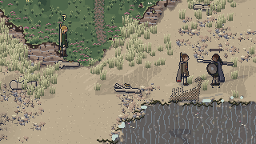
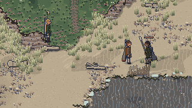
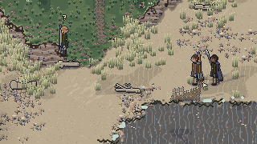
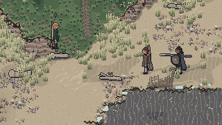
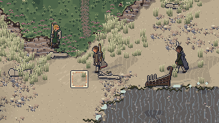
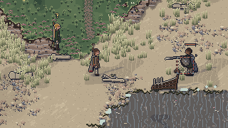
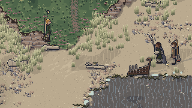
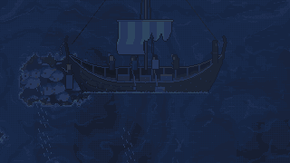
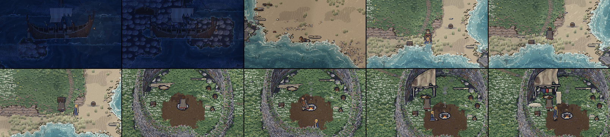

# REWORK 2.4 REPORT: combat v2 and the new opening, before the Build 1 gate

In the Book 2 section 23 format: one heading per report field. This is the combined report for the
design addendum 2.4 rework (decisions DE-1 to DE-80 in `docs/decision-log.md`), a change request
after the Build 1 gate and before Stage 13 (DE-33). It was built in two parts, each with its own
report, and closed by a final pass (golden saves, the full checks, the gate's captures and this
report):

- **Combat v2 and the arrow fix** (addendum section 1; DE-1 to DE-15 folded, DE-35 to DE-59 built):
  [rework-2.4-combat.md](rework-2.4-combat.md).
- **The opening, guidance, world fixes and music fades** (addendum sections 2 to 6; DE-16 to DE-34
  folded, DE-60 to DE-79 built): [rework-2.4-opening.md](rework-2.4-opening.md).
- **The final pass** (DE-80): golden save 10 frozen, golden save 11 made; the Stage 12 capture
  brought to the 2.4 game.

**The Build 1 gate now covers this rework** (see [stage-12.md](stage-12.md)): the user playtests
Chapter 1 as 2.4 plays it, and Stage 13 waits for the user.

## Implemented
**Combat v2** (full list in [rework-2.4-combat.md](rework-2.4-combat.md)): the combat stance facing
the cursor with forward, strafe and back-off speeds; lock-on (Z, middle mouse, pad R3) with the
camera centred between the two; attacks that commit, reach for every weapon, lunges; nine weapon
movesets and their rules (the axe hook, the spear's edge, the sword's parry, the Dane axe's guard
break, mail by damage type); poise, flinch, stagger, knockdown and get-up; the bigger parry (14
ticks of hitstop, a star and a ring, the attacker open 60 ticks) and a heavy riposte; guard stamina
and guard breaks; enemies that want to live (holding off, circling, stepping in and out, backing off
when hurt, calling for help, falling back, one or two pressing while the rest circle, cornered
runners surrendering); hit reactions with hitstop as a held clock in the simulation; health and
stamina as two fading bars and a thin enemy bar; exhaustion; healing with bindings and rations (H);
arrows swept against every body, shield and piece of cover each tick, so none passes through
anyone; shields that stop arrows; aware enemies' sidesteps; sneaking with footfall noise, awareness
and the "?" and "!" marks; backstabs; warnings at 8, 5 and 3 tiles; checkpoint autosaves (before
set-piece fights, on reaching camp, on waking); the scavengers at dusk (Svart and Conn at the stern,
a fight built to teach the parry, or walk away, bargain or sneak); world state version 11.

**The opening** (full list in [rework-2.4-opening.md](rework-2.4-opening.md)): the played cold
open at sea and the waking in the surf; Hild in the net, the seax on the way and the hold-to-cut;
Thorkel's locked chest carried to its outline at the camp; the first fire, Hild walking up at its
smoke, the sail raised between the oars in one visible action; the key from Thorkel's body however
Bran's search ends, the chest opened (the bow, quiver, chart fragment, bindings, comb, whetstone);
the bow's first use on the mast stores; Oddi's dilemma over the ship's silver in its strongbox;
Runa's "Where have you put it?"; every rescued person getting up, walking to the camp, working and
sleeping under the shelter; guidance in speech with no markers (19 aims, the journal on J, stuck
hints); "Nothing that way" at edges; doors (the broch's door, the shelter's flap); the shelter's
inside; the Hag's Stone's hush, cold light, hold, gust and settle; music that fades in and out; the
silver arm-ring, the seal, the gulls and the crab; the first night's fire with Hild.

**The final pass** (this session):
- **Golden saves** (DE-80): golden save 10 is frozen like goldens 1 to 9: its test loads it through
  the migration chain to version 11 and plays on, and no longer makes it again from its scenario
  (that scenario began with the opening 2.4 replaced). **Golden save 11** (schema 11) is the new
  chapter-end save: the world of the chapter run, `playChapter('chapter-1')` at the scripted pace
  (`src/tools/play/chapterRun.ts`), the same run whose telemetry is given under **Timing**. It plays
  the 2.4 Chapter 1 from waking to the sea map closed: the new opening, the scavengers at dusk left
  alone, the first night's fire, Oddi's strongbox first, Runa by a confession at the Hag's Seat and
  her question answered truly, Bran's search by a fight at the fold (combat v2's first fight), the
  key from the body, the chest and the bow, the mast stores, the boards and rigging, the oar found
  once all three scavengers fell, the extended hold, the sea burial, and the launch as Grey Seal
  under a woad raven. `npm run golden` now writes only golden 11, and a test checks that its
  scenario reproduces it exactly (`src/tools/saves/golden.ts`, `tests/unit/saves.test.ts`,
  `tests/golden-saves/README.md`).
- **The Stage 12 capture shows the 2.4 game** (`src/tools/art/capture.ts`): the strand's still now
  starts in play, awake where the steerer gets up, because the naming screen leads into the cold
  open at sea (DE-67; `standard.spec.ts` does the same); and two 2.4 views join the gate's
  capture: the camp with the sail raised (`camp-sail`) and the scavengers at the stern at the first
  dusk (`dusk-stern`).
- **A test for "music never starts or stops at full volume except stingers"** through the game's
  own router and content (see **Tests**).

## GIFs
Captured from the real game (`npm run capture -- rework-2.4-combat` and `-- rework-2.4-opening`),
each under 4 MB.

**A parry and riposte** (`docs/art/rework-2.4/combat/parry-riposte.gif`, 0.18 MB): Svart's slow
heavy with its large tell, the parry's star and long hitstop, Svart reeling open, the riposte, the
fall.

**Backing away while locked on** (`back-off.gif`, 0.49 MB): locked on to Svart, backing off west and
strafing, the stance facing him throughout.

**Hit reactions to a light and a heavy hit** (`hit-reactions.gif`, 0.35 MB): a light seax hit
(flinch, knockback, flash, spray), then a charged heavy (stagger, shake).

**A hurt enemy backing off** (`hurt-backs-off.gif`, 0.53 MB): Svart badly hurt, holding off further
and backing away as the steerer presses.

**An arrow blocked by a shield** (`arrow-blocked.gif`, 0.25 MB): an arrow into Svart's raised
shield, the thunk and splinters, the arrow stuck in the board.

**An arrow dodged** (`arrow-dodged.gif`, 0.22 MB): aware Svart reading the draw and sidestepping;
the arrow passes.

**A backstab** (`backstab.gif`, 0.26 MB): Svart at work, unaware; the heavy strike and the fall.

**The first five minutes** (`docs/art/rework-2.4/opening/first-five-minutes.gif`, 3.72 MB, 28.8 s
at 10 frames a second; and the strip of ten key frames, `first-five-minutes-strip.png`): the cold
open steered with the keys, the strike, the waking, the seax, the net cut, Hild carried up,
Thorkel's chest dragged home, the first fire, Hild walking up, the sail raised, under the sail.

## Tests
TESTS_PLACEHOLDER

## Stages 7 to 12 redone
STAGES_PLACEHOLDER

## Gate checks
GATE_PLACEHOLDER

## Timing
TIMING_PLACEHOLDER

## Art check
ART_PLACEHOLDER

## Balance
BALANCE_PLACEHOLDER

## Deviations
DE-1 to DE-80 in `docs/decision-log.md` ("Design addendum 2.4" and its three building sections),
each with its reason. None departs from Book 1's intent.

## Known issues
KNOWN_PLACEHOLDER

## Flagged for the user's review
FLAGGED_PLACEHOLDER

## Next stage ready
No. This rework comes before the Build 1 gate, which now covers it: the user playtests Chapter 1
as 2.4 plays it (`docs/playtest/build-1.md`), and Stage 13 (sea-map travel) waits for the user's
word.
