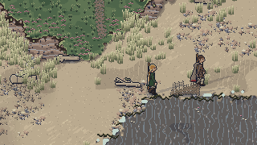
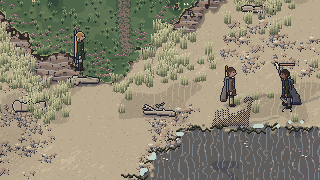
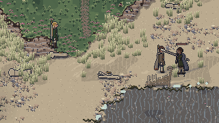
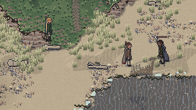
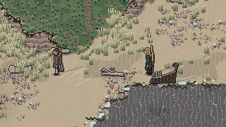
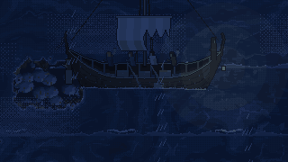

# REWORK 2.5 REPORT: committed combat, less text, the storm and the rescue fix, before the Build 1 gate

In the Book 2 section 23 format: one heading per report field. This is the combined report for the
design addendum 2.5 rework (decisions DF-1 to DF-86 and DE-82 to DE-88 in `docs/decision-log.md`),
a second change request after the Build 1 gate and before Stage 13 (DF-20). It was built in four
parts, three with their own report or log section, and closed by a final pass:

- **Oddi and every rescued person** (addendum section 4; DF-18 folded, DE-82 to DE-88 built): the
  decision log's "Building the rescue fix (Oddi on the sand)", summarised under **Implemented**.
- **Committed combat** (addendum section 1; DF-1 to DF-10 folded, DF-23 to DF-49 built):
  [rework-2.5-combat.md](rework-2.5-combat.md).
- **On-screen text and the storm opening** (addendum sections 2 and 3, and 2.4's unbuilt items;
  DF-11 to DF-17 and DF-21 folded, DF-50 to DF-70 built):
  [rework-2.5-text-storm.md](rework-2.5-text-storm.md).
- **The final pass** (DF-83 to DF-86): what 2.5 asked for that the combat build left out, the cause
  of the longer chapter, golden save 11, the full checks, the gate's captures and this report.

**The Build 1 gate now covers this rework** (see [stage-12.md](stage-12.md)): the user playtests
Chapter 1 as 2.5 plays it, and Stage 13 waits for the user.

## Implemented
**Oddi and every rescued person** (DE-82 to DE-88). The cause of Oddi standing unanswering on the
sand: the get-up clock started at *any* set-down of a rescued person, but Oddi was rescued only when
set down *off* his strand, so set down above the tide line on Wreck Strand (as the opening teaches
with Hild) he stood up without joining the household: no day moved him, talk refused him and,
standing, he could no longer be lifted (DE-82). Now he is rescued wherever he is set down safe,
including when a winded steerer drops him above the tide line; the moment he is, the
wreck-scavengers take the strongbox if it still lies on the strand, so the dilemma stands (DE-85).
The rescue scenario test found three more faults, all fixed: a resident downed and carried home kept
the fight's walking goal and hovered by its bed (DE-84); residents could not route through a zone
that shares no edge with their place (DE-88); and Hild in the net followed the tide out onto the
flats, out of reach for 45 minutes in the evening (DE-87). Interact goes to Hild first while she is
in the net (DE-86), and Hild's walk home is counted from the first fire's smoke (DE-83).

**Committed combat** (full list in [rework-2.5-combat.md](rework-2.5-combat.md)): wind-up, active
and recovery for every action with no cancels, player and AI alike; a missed attack adds its miss
recovery and a blow in any recovery is a punish; acceleration and deceleration, and no movement while
attacking; exhausted at an empty bar (no attack, parry, dodge, block or run, half speed, until 30%);
the predictive parry with its own frames; the slower block at half speed and its guard break at an
empty bar; the costly dodge with its mid-dash invulnerability and planted recovery; the AI on a state
machine deciding every 15 ticks, circling outside its reach and waiting for an opening; archers that
stand still to shoot, hop back once and draw a sidearm when cornered; telegraphs by weight (draw-back,
a one-frame flash 28 ticks before the blow, a sound by weight); no combat text, the awareness marks
off by default; locked-on attacks going at the enemy (the user's DF-81); save version 12.

**On-screen text and the storm** (full list in
[rework-2.5-text-storm.md](rework-2.5-text-storm.md)): at most one information line and one speech
line, replacing and never stacking, repeats suppressed, bottom centre above the hotbar; in a fight
only speech and safety lines; the text audit of every message; tutorial prompts that fade in story
beats and go once done; the cursor hidden in cinematic moments; the storm's lightning, thunder, two
layers of mist, light varying in patches, camera sway, swells with foam, waves breaking on the hull,
spray, green water and a pitching, rolling ship; rain on the sail cloth in the first rain; the Hag's
Stone's own reserved accent; Runa seated at the boat while wounded; the mast stores in wadeable
shallows at any tide (the user's DF-82).

**The final pass** (this session):
- **The four commitment sounds of Book 11 section 07** (DF-83; `src/audio/synth/combat2.ts`): the
  parry's wind-up rasp (the guard coming up, no ring), the block's soft leather creak as the shield
  is raised, the dodge's heavy landing into its planted recovery, and a whiff's whoosh carrying on
  into an overbalanced scuff. A new fight event, `COMMIT_SOUND`, carries the first three on the tick
  their phase begins; the whiff plays on `MISSED`. Each cue has its drawn twin and no caption
  (DF-80); they are on the sound test page and in the renders.
- **The missing frames** (DF-83; `assets/art/authoring/people48.py`, palette-indexed, compiled
  through `art:adopt`, `art:sheets` and `art:compile`): a walk start of 2 and a walk stop of 2, the
  run start lengthened to 2, the block walk forward, backing off and strafing (6 frames each at half
  the stride, shield or guard up), and a miss's overbalance of 2 (pitched over the front foot, the
  weapon low past the line, then the weight caught on a further step), with a spear's own drawing.
  They are on the steerer's two bodies, the heavy build and the three scavengers, and on Oddi and
  Bran (the same states for every fighting build); Hild and Runa gain only the run start's second
  frame. In play: the overbalance fills the first 70% of a miss recovery, the block walk shows
  whenever a raised shield moves, the steerer's start and stop play from the keys and a fighter's
  from its eased speed against Book 10's walk (`rampFrame`, `src/scenes/zoneScene.ts`;
  `src/scenes/zoneVisuals.ts`). They replace DF-38's stand-ins.
- **The enemy's second light** (DF-84; `secondLight` in `src/sim/land/fight.ts`): Book 10's
  enemyStrings is built. A warrior, raider or huscarl whose first light met its target presses
  again in the light's chain window, so a second light follows with its own wind-up under the floor
  and its own flash; never after a whiff or a parry, never a third. No Chapter 1 enemy strings
  lights (the scavengers fight as outlaws); it waits for Stage 13's warbands in play.
- **The timing regression, found** (DF-85; see **Timing**): a bot artefact, already fixed in the
  tree before this pass. Nothing was changed for timing.
- **Tests fixed**: `missiles.test.ts` "the bow cannot be had before the chest is opened with the
  key" now proves its point under DE-86 (Interact goes to Hild in the net and lifts nothing; the
  chest clicked on its own tile is lifted, unopened; with Hild free, Interact lifts it, unopened; no
  bow at any point). The Seal Cave theft scenarios in `tests/scenario/repairs.test.ts` pass as they
  are (13 of 13).
- **Golden save 11 regenerated** at schema 12 (DF-86): `npm run golden`; its test checks the 2.5
  chapter's end and that its scenario reproduces it exactly. Goldens 1 to 10 are untouched.

## GIFs
Captured from the real game, each at 1x and under 4 MB. The combat clips were captured again in this
pass (`npm run capture -- rework-2.5-combat`) so they show the final frames, the overbalance
included; the storm clip is the text-and-storm session's (`npm run capture -- rework-2.5-storm`).

**A missed attack punished** (`docs/art/rework-2.5/combat/punish-miss.gif`, 0.59 MB): Conn's seax
whiffs at the steerer's dodge; he stumbles forward over the miss (the new overbalance frames) and the
steerer strikes him in his miss recovery, a punish with the heavier hitstop.

**A successful predictive parry** (`parry-predictive.gif`, 0.47 MB): the parry pressed off Svart's
tell, in his wind-up, its live frames over his blow; he is stunned and riposted.

**A guard break** (`guard-break.gif`, 0.28 MB): blows on Svart's raised shield empty his bar; the
guard breaks with the large stagger, the shield arm flung wide, the knockback. (He is held on his
spot until it breaks; everything after plays freely.)

**An enemy circling and waiting for an opening** (`circle-wait.gif`, 0.56 MB): Svart circles just
outside his reach for 121 frames and steps in only when the steerer's bar runs out.

**An archer backing off** (`archer-backs-off.gif`, 0.69 MB): Conn stands completely still to draw
and loose, hops back once when crowded, resets, and draws his seax when crowded again.

**The storm opening** (`docs/art/rework-2.5/storm/storm-opening.gif`, 3.97 MB, 265 frames at 6 a
second): the night sea with swells, foam and mist, the lightning's double flicker lighting the ship,
sea and skerry, the camera's sway, waves breaking on the hull with spray, the pitching ship, the
strike and the black, to the waking.

## Tests
- `npm run lint`: **clean.** ESLint, Prettier, content lint (1368 strings, 522 registered IDs) and
  art lint (146 sheets, 47,742 frames, 0 placeholders).
- `npm run build`: **builds** (the usual large-chunk warning only).
- `npm test`: **52 files, 800 tests: 799 passed, 1 skipped, 0 failed**; then the frame-budget pass
  timed alone (`OE_BUDGET=1`): 1 passed (its other 7 skipped by design). The skipped test in the
  main run is that budget test. (Before this pass: 790 passed, 2 failed, 1 skipped; the first full
  run in this pass had 3 failures, all the new frames' expected counts and order, then fixed.)
- `npm run test:browser -- --project=chromium`: **77 passed, 0 failed** (5.6 min, one full run, no
  reruns). The standard on Wreck Strand: **96.4%** continuous motion with the camera still
  (threshold 80%), **62.8%** with reduced motion and low detail (threshold 50%), **4.38 ms** of
  script a frame (budget 5.5); the cold open **97.6%**, **3.92 ms**.
- WebKit was not run here: its browser cannot be downloaded in this environment (the download
  fails). CI runs Chromium and WebKit, and both block publishing.
- No threshold, standard or budget was changed. No probe or scratch tests are left in the tree (the
  earlier `tests/unit/probe25.test.ts` was already gone; none were made in this pass).
- CI results: see the run for this commit.

**The tests the user asked for** (all pass):

| Asked for | File | Test |
|---|---|---|
| Actions can't be cancelled | `tests/unit/combat25.test.ts` | "commitment: three phases, no cancels (Book 10 \"Commitment\"; DF-1)": "the steerer: a light / heavy / charged / lunge / riposte / backstab / shove / parry / dodge / heal plays wind-up, active and recovery, and no press changes it" and the same twenty for "an enemy (the AI)"; "a block raise and lower commit; the held guard is live and walks"; "in the zone: during an attack the keys neither move nor turn the steerer, and a dodge is refused". In the browser: `tests/browser/combat25.spec.ts` "locked on, an attack goes at the enemy with the cursor elsewhere; and it commits" |
| Missed attacks leave a punishable window | `tests/unit/combat25.test.ts` | "a missed attack is punished (Book 10 missRecovery, punish; DF-1)": "a whiff adds its move’s miss recovery for every weapon", "in the zone: an attack landed in the miss recovery is a punish (heavier hitstop and poise)"; "the AI state machine": "a whiff is an opening as long as its recovery and miss recovery last, read from the drawn pose"; and new, "the frames that finish 2.5": "a whiff shows the overbalance’s two frames in its miss recovery, then the follow-through" (clip: `punish-miss.gif`) |
| The exhausted rules apply | `tests/unit/combat25.test.ts` | "exhausted at an empty bar (Book 10 \"Exhausted\"; DF-3)": "no attack, parry, dodge, block or shove at zero", "in the zone: half speed, its pause and slower refill, and back at the threshold"; `tests/browser/combat25.spec.ts` "exhausted at an empty bar: no dodge, and half speed until the bar is back" |
| Parry timing works | `tests/unit/combat25.test.ts` | "the predictive parry (Book 10 \"Parry\"; DF-4)": "started in the attacker’s wind-up with its live ticks over the blow, it parries", "too early it recovers open; too late its wind-up is hit: both leave the parrier open"; `tests/browser/combat25.spec.ts` "the predictive parry: pressed in Svart’s wind-up off his tell, it stuns him" (clip: `parry-predictive.gif`) |
| A guard breaks at zero stamina | `tests/unit/combat25.test.ts` | "blocking (Book 10 \"Block\"; DF-5)": "a hit that empties the bar breaks the guard with the large stagger, then exhausted" (clip: `guard-break.gif`) |
| No more than two text lines show at once | `tests/unit/text25.test.ts`; `tests/browser/text25.spec.ts` | "the caption view (DF-11)": "shows at most one information line and one speech line, however many arrive at once", "never shows more than one of each, nor a non-safety line in a fight, over random streams" (a property test); in the browser: "a burst of messages leaves one information line and one speech line, never stacked" (checked every frame for 2 s) |
| The Oddi scenario passes | `tests/scenario/rescued.test.ts`; `tests/browser/rescued.spec.ts` | "everyone rescued walks to camp, works, eats, sleeps under the shelter and talks (DE-22, DE-82)": 32 runs, 15 of them Oddi's (each time of day, both search choices, set down on his strand or off it, the steerer staying, leaving, sleeping or fighting, across a save and load); "Oddi’s rescue and the opening’s reach (DE-85 to DE-88)": "Oddi dropped by a winded steerer above the tide line is rescued there, and limps home"; in the browser, played with the keys as the user did: "Oddi set down on his strand is rescued there: he limps home to the camp and talks" |

**New in this pass** (`tests/unit/combat25.test.ts`, 7 tests): "the sounds of commitment": "a
parry’s wind-up, a shield raised, a dodge landing and a whiff each send their sound", "each is a
generated cue with its drawn twin and no caption (DF-80)"; "the frames that finish 2.5": the
overbalance test above, "a raised shield walked is the block walk: forward, backing off or
strafing", "speed builds through the walk start’s two frames and dies through the stop’s"; "an
enemy’s second light": "a warrior, raider or huscarl follows a light that met its target with a
second, told again", "an outlaw (the scavengers) never strings two". Updated: `water.test.ts` (the
steerer's walk begins with the start's two frames and ends with the stop's; the run's lean is two
frames and a run let go skids), `strandArt.test.ts` and `art.test.ts` (the new frame counts and
atlas packing), `saves.test.ts` (golden 11 at schema 12), `missiles.test.ts` (above), and
`sound.spec.ts` (four more buttons).

**Golden saves** (`tests/unit/saves.test.ts`, 30 tests): goldens 1 to 10 load through the
migration chain to version 12 and play on; golden 11 "loads, matches its hash and holds Chapter 1 as
2.5 plays it, ended" and "is reproduced exactly by its scenario".

## Stages 7 to 12 redone
Each stage's tests were run again in this pass (unit and scenario tests by stage, then the
stage's browser specs in the full Chromium run). Every one passes.

| Stage | Unit and scenario tests run again | Browser specs |
|---|---|---|
| 7 | 60 passed (`home`, `driftwood`, `homeAudio`, `workLoops`) | `stage07.spec.ts` 6 passed |
| 8 | 96 passed (`people`, `synth`, `audioCoverage`, and the rescue scenario `rescued`) | `stage08.spec.ts` 4, `rescued.spec.ts` 1 passed |
| 9 | 166 passed (`combat25`, `combat2`, `combat`, `missiles`, `water`) | `stage09.spec.ts` 4, `combat2.spec.ts` 4, `combat25.spec.ts` 4 passed |
| 10 | 51 passed (`searches` scenario, `opening2`, `omen`, reachability `southern`) | `stage10.spec.ts` 2, `opening2.spec.ts` 5, `opening.spec.ts` 2 passed |
| 11 | 37 passed (`repairs` scenario, `ship`, `shipArt`) | `stage11.spec.ts` 4 passed |
| 12 | 87 passed (`launch` scenario and unit, `saves`, `text25`, `storm25`) | `stage12.spec.ts` 4, `text25.spec.ts` 5, `storm.spec.ts` 2, `standard.spec.ts` 2 passed |

### Stage 7: day and night, shelter and first tasks
**What 2.5 changed:** the on-screen text (the camp's work, fire, door and sail sounds and moments
are seen, not captioned; the prompts fade in story beats and go once done; DF-11 to DF-13); the
first rain falls on the camp on the first night, with rain on the sail cloth and its patter under it
(DF-60); the steerer's walk now starts and stops over its frames (DF-83).
**Its checks now:** 1 and 2 hold (`home.test.ts`; `stage07.spec.ts` "sleeps after 18:00 to dawn,
and the morning report is written"). 3 and 4 hold (`home`, `workLoops`). 5 (the stamina bar and its
reasons) holds; the bar now also shows exhaustion at zero by the body and breath, not words. 6 (the
standard): the camp with the sail raised 83.2% in the gate capture (2.4: 82.8%). 7 (audio): the
rain on the cloth renders (0.087 peak, soft by design, heard only under the sail); the camp sounds
it cut from the captions keep their sounds.

### Stage 8: crew agents, schedules and conversation
**What 2.5 changed:** every rescued person gets up, walks to the camp, works, eats, sleeps under the
shelter and answers talk, whatever the time, route or what the steerer does next (DF-18, DE-82 to
DE-88); residents route through the zone graph (DE-88) and leave a fight's walk once out of it
(DE-84).
**Its checks now:** 1 (Hild useful at once and always doing something) holds
(`stage08.spec.ts`). 2 (a wound as a topic) holds. 3 (the deltas, thresholds and bands) holds
(`people.test.ts`). The rescue scenario test (Book 2 section 23) runs 32 rescues of Hild, Oddi, Bran
and Runa (`rescued.test.ts`) and the browser plays Oddi's as the user did (`rescued.spec.ts`). 4 (the
standard) is covered by the camp view. 5 (voices): unchanged; speech lines still carry the voice
blips, now on the single speech line.

### Stage 9: combat
**What 2.5 changed:** combat v2 becomes committed combat (DF-1 to DF-10, DF-23 to DF-49): three
phases with no cancels, the miss recovery and the punish, acceleration, exhaustion, the predictive
parry, the slower block and its guard break, the costly dodge, the AI's state machine and
distances, archers that stand to shoot, telegraphs by weight, no combat text; this pass adds the
four commitment sounds, the block walk, the overbalance, the walk start and stop, and the enemy's
second light (DF-83, DF-84).
**Its checks now:** 1 (frame data matches Book 10, every tell at least 6 ticks before its active
frames) holds against 2.5's frame data, with enemy wind-ups at their floors (28 ticks or more) and
the flash 28 ticks before every blow (`combat25.test.ts` "an enemy’s wind-up meets its floor and
hold; the rows of \"Enemy attacks\" follow", "in the zone: an enemy’s flash comes 28 ticks before
its blow, with its weight"). 2 (a parry in the window staggers the attacker; a full charge breaks a
block but not a parry) holds, the parry now predictive (`combat25.test.ts` "the predictive parry";
`combat.test.ts`, `combat2.test.ts`). 3 (missiles; no one moves while drawing) holds and archers now
also stand still to settle and recover (`missiles.test.ts`, `combat25.test.ts` "archers";
`stage09.spec.ts`). 4 (the steerer's death; a downed ally never dies on a timer) holds
(`stage09.spec.ts`). 5 (the standard): the dusk at the stern 89.1% in the gate capture; the five
combat clips. 6 (audio): eleven new combat sounds in 2.5 (seven in the combat pass, four in this
one), all under the ceiling, none captioned (DF-80).

### Stage 10: the three searches and the southern island
**What 2.5 changed:** Oddi is rescued wherever he is set down safe, and the scavengers take the
silver at that moment if it is still on the strand (DE-85); Interact goes to Hild first in the net
(DE-86); Hild keeps to the foreshore (DE-87); the mast stores drop into shallows wadeable at any
tide (the user's DF-82, DF-53); the fold met during the dusk (DF-43).
**Its checks now:** 1 (two viable approaches a search, recorded as a fact) holds for all six
(`searches.test.ts`), with Oddi's two choices played every way in the rescue scenario test. 2
(reachability at high and low tide) holds (`tests/reachability/southern.test.ts`), and Hild in the
net is reachable every 20 minutes of a day (`rescued.test.ts`). 3 (the Hag's Seat declares sign,
rule, response and consequence) holds (`omen.test.ts`). 4 (the standard): no southern view changed in
this pass; the Stage 10 captures stand. 5 (audio): unchanged.

### Stage 11: boat repairs and the first fitting
**What 2.5 changed:** wounded Runa works seated beside the boat, off the steerer's work tile (DF-52);
the Seal Cave fights are 2.5's.
**Its checks now:** 1 (each repair visibly changes the boat) holds (`shipArt.test.ts`;
`stage11.spec.ts`). 2 (`deriveStats` for T1 with each fitting) holds (`ship.test.ts`). 3 (no task
asks for a large count) holds (`repairs.test.ts`, including the Seal Cave theft scenarios). 4 (the
standard): the launch views below. 5 (audio): unchanged.

### Stage 12: the launch and the Build 1 gate
**What 2.5 changed:** the storm opening (DF-15 to DF-17); the text rules on every screen; golden save
11 regenerated at schema 12 (DF-86); the playtest script brought up to 2.5.
**Its checks now:** see **Gate checks** below.

## Gate checks
1. **Chapter 1 takes 45 to 60 minutes for a new player, with combat inside 25 minutes (by
   telemetry): MEASURED, NOT PROVEN.** The scripted route takes 58.6 minutes at the bot's pace and
   61.6 at a human pace; the first fight is at 16.9 to 17.7 minutes (the fold), and the dusk fight is
   on offer from about 10 minutes. The 82 minutes reported mid-rework was a bot artefact (DF-85).
   See **Timing**.
2. **User playtest: READY.** `docs/playtest/build-1.md` is brought up to 2.5 (a "Fighting" section on
   reading wind-ups, parrying early, blocking, dodging and stamina; the marks off at first; the
   stores in the shallows; rescues set down anywhere safe).
3. **Art lint clean for every Build 1 asset, no placeholders: PASS.** 146 sheets, 47,742 frames,
   0 placeholders.
4. **The Book 7 section 14 standard: PASS** for every in-world view of the gate capture (83.2% to
   94.1% against 80%; see **Art check**), the strand in the browser (96.4%) and the cold open
   (97.6%).
5. **The browsers block publishing:** Chromium passed here (77 of 77); WebKit runs in CI, and
   `deploy` needs both. CI results: see the run for this commit.
6. **Audio: PASS.** Every new sound renders under the ceiling and was measured against the sounds
   beside it (see **Balance**, and the two part reports). I cannot hear the renders: the user should
   listen in the sound test.

## Timing
Measured by the telemetry, the scripted player playing the whole chapter through the simulation's
commands (`node src/tools/play/chapterRun.ts chapter-1 [human]`, seed chapter-1; the bot route is
golden save 11). The clock starts at the waking.

**The cause of the 82 minutes** (DF-85). The figure came from the shared tree mid-rework. Run at
each commit of the rework, the human pace gives:

| Commit | Chapter's end | The bow | The stores | The hull |
|---|---|---|---|---|
| 34d66b6, 512afaf | 82:16 | 22:09 | 23:48 (day 2 20:15) | 69:22 (day 6) |
| 5e1df63, 5227ad5 | 61:33 | 19:35 | 20:47 | 49:05 (day 5) |
| 291a6c3 and this pass | 61:33 | 19:55 | 21:07 | 49:05 (day 5) |
| 291a6c3 with the bots' old path loop put back | **82:16** | 22:39 | 24:18 | 69:22 (day 6) |

Between 512afaf and 5e1df63 the simulation changed in one place, a fight's cliff-edge avoidance
taken out (DF-42), and the scripted players changed (`openingBot.ts`, `campBot.ts`). Once acceleration came in, they eased off the keys
near *every* waypoint of their path, which is every tile, so they walked most of the way at a
fraction of the walk; 5e1df63 lets them pass a waypoint where the path runs straight on at full
speed. Putting the old loop back on 291a6c3 alone, with the simulation as it is now, gives 82:16 to the
second, so the bots' loop is the whole cause. The 20 minutes are one
whole game day: the slow walking pushed the stores past dark on day 2 and the hull's work, which
waits on the tide and the day, to day 6. **It was a bot artefact, and it was already fixed.** The
suspects in real play barely move the run: the chest reaches the camp 6 s later than in 2.4 (the
carry eases up and down and can end winded), the stores are fetched 1:12 after the bow (2.4: 1:26,
now in the shallows at any tide), the first rain is presentation only, and the bots' fights end
when they did. Nothing was changed for timing, and nothing was padded or cut.

| Mark | Bot pace | Human pace | 2.4 human | Book 10 target |
|---|---|---|---|---|
| seax | 0:05 | 0:05 | 0:05 | seaxBy 1:30 |
| Hild cut free and safe | 0:39 / 0:40 | 0:39 / 0:40 | 0:37 | hildFreedBy 2:30 |
| the chest at the camp | 1:13 | 1:19 | 1:13 | chestAtCampBy 4:00 |
| the first fire | 2:19 | 2:31 | 2:22 | firstFireBy 5:00 |
| the sail raised | 3:08 | 3:20 | 3:11 | shelterBy 6:00 |
| Hild's leg tended | 4:11 | 4:31 | 4:19 | |
| the dusk over (the scavengers left alone) | 10:42 | 10:42 | 10:42 | firstFight "about 12 minutes" |
| the first night | 11:25 | 11:25 | 11:24 | |
| Oddi / Runa / Bran | 13:05 / 14:50 / 17:39 | 13:20 / 15:24 / 18:23 | 13:12 / 15:10 / 17:23 | |
| the first fight (the fold) | 16:55 | 17:39 | 17:16 | Book 1: inside 25 minutes |
| the bow (the chest opened) | 19:10 | 19:55 | 18:50 | bowBy 20 to 30 |
| the mast stores | 20:22 | 21:07 | 20:16 | |
| the hull, rigging and oar | 48:05 to 48:41 | 49:05 to 49:41 | 51:12 to 51:52 | |
| the fitting | 49:32 | 50:49 | 52:57 | |
| the rites | 58:10 | 59:29 | 60:16 | |
| the launch | 58:20 | 60:55 | 61:41 | |
| **the chapter's end** | **58:38** | **61:33** (2:50 of it held by menus) | 62:19 | **45 to 60 minutes** |

Stated honestly against Book 10:
- **The chapter's length**: 58:38 at the bot's pace, inside the range; **61:33 at the human pace,
  1:33 over it**, 46 s shorter than 2.4's. The bots walk straight to every goal and never search,
  and about 28 minutes of the run is the wait from the stores (day 2) to the repairs (day 5) with the
  bot awake through the nights, which a player who works the boat by hand and sleeps through the
  nights cuts. My estimate for a new player stays about 50 to 65 minutes; the playtest will tell.
- **The first minutes** are all inside their targets.
- **The bow** comes at 19:10 and 19:55, a few seconds before bowBy's 20 to 30 (as in 2.4; Book 10's
  limit of 30 holds).
- **Combat inside 25 minutes**: the dusk fight is on offer at about 10 minutes and the bot's first
  fight at the fold comes at 16:55 to 17:39. A player can still avoid every fight (Stage 12's flag).
- This pass's own changes leave the run unchanged to the second (run again after them).

## Art check
Captures in `docs/art/captures/stage-12/` (`npm run capture -- stage-12`, run in this pass on the
2.5 game; its README lists every file). The capture also rewrote three files of
`docs/art/mockups/stage-12/` (as at Stage 12 and 2.4); they were restored from 291a6c3 afterwards, so
`docs/art/mockups` and `docs/art/stage-06-rework` match 291a6c3.

**Motion with the camera still** (Book 7 section 14, 80% of cells), every in-world view:

| View | Moving cells (2.4) |
|---|---|
| Wreck Strand where the steerer gets up (`still`) | 94.1% (93.9%) |
| The boat ready on its skids (`launch-ready`) | 88.9% (88.9%) |
| The heave and the run down the skids (`launch-heave`) | 91.7% (91.7%) |
| Afloat under the mark, rowing (`launch-sail`) | 93.1% (93.1%) |
| The camp with the sail raised, the fire lit (`camp-sail`) | 83.2% (82.8%) |
| The first dusk at the stern, Svart and Conn (`dusk-stern`) | 89.1% (88.7%) |
| The strand in `standard.spec.ts` (and with reduced motion and low detail) | 96.4% (62.8%, threshold 50%) |
| The cold open in `storm.spec.ts` | 97.6% |
| The sea map (a screen, not an in-world view; for the record) | 72.9% |
| Book 7 threshold | 80% |

Every in-world view meets the threshold; the lowest is still the camp, where the broch's dry-stone
walls fill much of the view. The 10-second clip is 10.0 s.

**GIF sizes**: the combat clips 0.28 to 0.69 MB, the storm opening 3.97 MB; every GIF is under 4 MB.

**Compared with `docs/art/reference/`** (`wreck-strand-target.png`, `kelda-summer-target.png`,
`target-walk.mp4`):
- **The strand** (`still`): the shingle, sand ripples, wrack, dune grass, the foam line and the
  moving sea match the reference's ground as at Stage 6 and 2.4; the steerer reads at 1x.
- **The fighters** (`dusk-stern`, the combat clips): the new frames keep the reference's outline
  weight, three-step shading and the 48 px body; the overbalance and the block walk read at 1x as a
  body pitched forward and a guard carried at a half stride. The telegraph's flash reads as a
  one-frame bright edge, as the reference's lighting does.
- **The storm** (the text-and-storm report): the reference is daylight; the storm keeps its palette
  and outline rules, with the light varying by patches and flashes rather than a flat blue.
- **Shortfalls** (as before): the heave has no pushing pose; the boat runs broadside down the beach.

**New art in this pass** (palette-indexed, compiled, rendered at 1x and 4x and inspected; art lint
clean, 0 placeholders): the walk start and stop, the run start's second frame, the block walk three
ways and the overbalance, on every fighting body. Review sheets at 1x and 4x with a GIF for each of
the steerer's two bodies, the heavy build and the three scavengers:
`docs/art/rework-2.5/finish/sheets/<who>_finish@1x.png`, `@4x.png` and `.gif`
(`assets/art/authoring/combat25_finish_review.py`). Inspected at 4x: the start leans into the first
step and the stop checks back with the hem swinging on; the run start's second frame drives the
knee through; the block walk keeps the shield (or guard) up at a half stride, with Svart's shield
square to the front; the overbalance pitches the body over the front foot with the weapon low past
the line, and the spear's version stays inside its cell after one fix (its first drawing ran off
the canvas facing east and west). No frame clips its cell.

## Balance
- Every number is read from `content/balance.json` (Book 10 revision 2.6). This pass added no Book
  10 row: the block walk's half stride follows Book 10's blockSpeed (half speed at the walk's
  timing), the start and stop frames are read against Book 10's walk, and the second light uses
  the existing chain windows, telegraph floors and flash lead. The frame splits (the overbalance
  over the first 70% of a miss recovery, the start and stop by 40%, 80% and 50% of full speed) are
  drawing splits like the dodge's and the parried's, not tuning (DF-83).
- **Listening back** (`npm run audio:render -- combat25`; peak / RMS, linear; the ceiling is about
  0.89). I cannot hear the renders; I measured them and compared them with the sounds beside them:

  | Sound | Peak | RMS | Length | Centroid | Drawn twin |
  |---|---|---|---|---|---|
  | The parry's rasp (`SFX_PARRY_RASP`) | 0.111 | 0.0152 | 0.12 s | 3.3 kHz | the parry's wind-up |
  | The block's creak (`SFX_BLOCK_CREAK`) | 0.160 | 0.0268 | 0.17 s | 1.0 kHz | the shield's raise |
  | The dodge's landing (`SFX_DODGE_LAND`) | 0.233 | 0.0412 | 0.15 s | 1.4 kHz | the planted recovery |
  | The whiff's scuff (`SFX_WHIFF_SCUFF`) | 0.200 | 0.0198 | 0.30 s | 3.8 kHz | the overbalance |

  Two were changed after the first render: the landing came out at 0.711 peak (as loud as the
  riposte; brought down to 0.233, with its sine thump the low end), and the creak sat on the block
  thud's own centroid (705 Hz against 700; raised to about 1 kHz so a raise and a hit on the shield
  are told apart). The rasp has no ring and sits well below the parry's ring (0.265); the
  landing's centroid is far below the dodge's push-off (7.4 kHz), so the push-off and the landing
  read as two sounds. The 2.5 combat sounds from the combat pass render as before.

## Deviations
DF-1 to DF-86 and DE-82 to DE-88 in `docs/decision-log.md` (the addendum's fold and its four
building sections), each with its reason. None departs from Book 1's intent. This pass's are DF-83
(the finishing frames and sounds), DF-84 (the second light), DF-85 (the timing's cause) and DF-86
(golden save 11 at schema 12).

## Known issues
- **The chapter runs a little long at a human pace** (61:33 against 45 to 60) and **the bow comes
  a few seconds early** (19:10 to 19:55 against 20 to 30). See **Timing**.
- **A fight can still be avoided** in all of Chapter 1 (as at Stage 12).
- **The second light is not seen in Chapter 1** (DF-84): no Chapter 1 enemy is a warrior, raider or
  huscarl; it is tested, and plays from Stage 13.
- **A seax's whiff is too short for an enemy to take in practice** (DF-29): an enemy light's
  28-tick floor is longer than a seax light's miss recovery, so the AI takes heavier whiffs, a
  mistimed parry, a dodge's recovery and exhaustion. The overbalance now shows every whiff.
- **The steerer's sheet has no shield layer**, so the steerer's block walk (and block) draws the
  guard with the arms; Svart and Ketill carry their shields in it.
- **The browser rescue spec plays Oddi's rescue only**; Hild's is played in the browser by the
  opening specs. Book 2 section 23 asks one browser rescue of each person; Bran's and Runa's are
  covered headless by the 32-run scenario test, not yet in the browser.
- **Cliff edges are not modelled** (DF-42): banks are walls in every zone.
- **The first rain is presentation only** (DF-60); **no bracing frames** for the people on deck in
  the storm (DF-62); **the skerry shows faintly between flashes**.
- **The sound test page names combat sounds** on its buttons (it is a listening page, not play); to
  be decided with the user whether DF-80's "any mode" covers it.
- **Cut caption strings stay** in the strings table, never shown (DF-69).
- **WebKit was not run locally**: its browser cannot be downloaded in this environment. CI runs it
  and it blocks publishing.
- **`docs/art/stage-06-rework`**: the eight `composite_wrecker_*` sheets added by commit 8a43138
  during 2.5 are still there (they did not exist when the folder was frozen); keep or remove.
- CI results: see the run for this commit.

## Flagged for the user's review
Every choice from DF-1 to DF-86 and DE-82 to DE-88 that wants the user's look, short and grouped.
Left out: DF-80, DF-81 and DF-82, which the user decided. The earlier lists in
[rework-2.4.md](rework-2.4.md) and [stage-12.md](stage-12.md) stand where 2.5 did not replace them.

**Combat: the feel**
- The punish: a blow on someone in any recovery or a broken guard gets the heavier hitstop and x1.5
  poise damage (DF-1).
- Exhausted until 30% of the bar (DF-3).
- An enemy's patience: after it, it attacks or feints without an opening (DF-7).
- The flash always 28 ticks before the blow, and the telegraph floors: an enemy seax light winds up
  for 28 ticks against the steerer's 10 (DF-9); the lights a little slower than combat v2's (DF-10).
- Healing is locked like any action; only a blow ends it (DF-25).
- How long an opening lasts as an enemy sees it, so a seax whiff is rarely punished by the AI
  (DF-29).
- The second light: only after a first light that met its target (DF-84).

**Combat: the look and the controls**
- The wind-up's frames: three draw-back states, the held top (DF-38).
- The new frames of this pass: walk start and stop, the run start's second frame (Hild and Runa
  too), the block walk three ways and the overbalance (DF-83;
  `docs/art/rework-2.5/finish/sheets/`).
- The combat pass's new frames and clips (`docs/art/rework-2.5/combat/sheets/`).
- Heal on the gamepad's command ring: let it go at its centre (DF-41).
- Light pools built into sight; cliff edges not modelled (DF-42).

**Text and the storm**
- The audit's cuts, chiefly the healing, door and opening-action captions (DF-13).
- The slot's name beside the hotbar, not above it (DF-57).
- The Hag's Stone's fifth reserved accent, *The Cailleach's cold light* (DF-50).
- The first rain's hours, 20:00 on day 1 to 04:00 on day 2, presentation only (DF-60).
- No bracing frames for the people on deck in the storm (DF-62).
- Where the mast stores land: carried by the swell to the stream's mouth, 4 tiles from under the
  lashing (DF-53).

**The rescues**
- Oddi rescued wherever he is set down safe, and the scavengers taking the silver at that moment
  (DE-85, the coordinator's ruling on DE-82's flag).
- Interact goes to Hild first while she is in the net (DE-86).
- Hild's walk home counted from the first fire's smoke (DE-83).

**Timing and bookkeeping**
- The chapter at 61:33 at a human pace, left as it is: the 82 minutes were a bot artefact (DF-85,
  replacing DF-70).
- Golden save 11 now holds schema 12, so its name no longer matches its schema (DF-86).
- The playtest script (`docs/playtest/build-1.md`) was brought up to 2.5 in this pass, with a short
  "Fighting" section.
- The `composite_wrecker_*` sheets in `docs/art/stage-06-rework` (see **Known issues**).

## Next stage ready
No. This rework comes before the Build 1 gate, which now covers it: the user playtests Chapter 1
as 2.5 plays it (`docs/playtest/build-1.md`), and Stage 13 (sea-map travel) waits for the user's
word.
