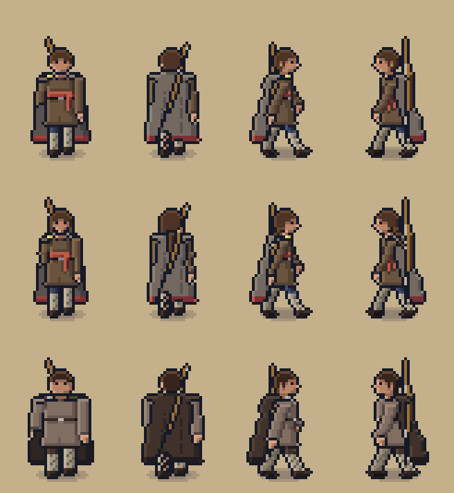
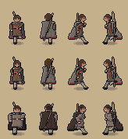
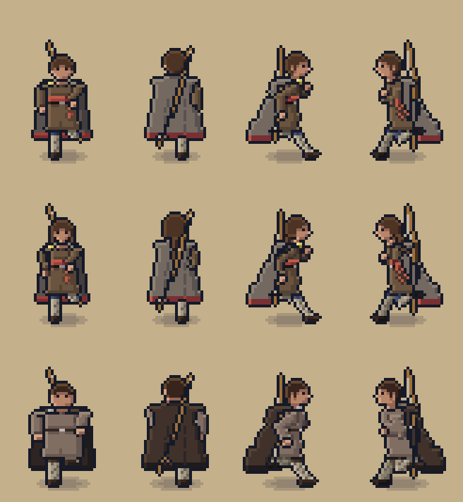

# STAGE 6 REWORK REPORT: people at 32 x 48, wading, controls, the run cycle and subtitles

A rework of Stage 6 under design addendum 2.2 sections 1 and 2, the user's scale, controls and
camera instruction, and addendum 2.3 sections 9 to 12. The characters were approved by the user
with changes (decision DB-1). Stage 7 has not been started. In the Book 2 section 23 format.

## Implemented
- **People at the new scale, in layers:**
  - The steerer's two body models and Hild are on 32 x 48 canvases, about 40 px tall.
  - Each is drawn in layers (body, clothing, cloak, and the bow) in each facing's order, with one soft oval shadow per person.
  - Animations:
    - a 6-frame walk with an exact 1 px drop;
    - the reworked 8-frame run (below), with a one-frame start and a two-frame skid and settle;
    - breathing, shift, glance and gust idles;
    - sneak, carry, the steerer's bow draw, and Hild's call.
  - The steerer has the madder sash and hem. Hild is in woad blue; her shawl is dropped (DB-1).
  - Frame selection comes from the distance walked, so the feet don't skate.
- **The run cycle** (addendum 2.3 section 12), for every facing, layer and build:
  - a forward tilt;
  - a suspension frame per stride with both feet off the ground;
  - the leading knee deeply bent and the torso dropping on the down frames;
  - the knee driven high, and the heel kicked up behind;
  - elbows near 90 degrees, pumping to chest height;
  - hair, hem, cloak and sash trailing a frame behind.
- **The heavy build** (addendum 2.3 section 11):
  - A third body for residents and enemies, never the steerer.
  - It has the full animation set, deeper down frames (2 px) and a 1 px flight, with its own clothing, cloak, helmet and bow layers.
  - It is adopted and linted, but not yet used in play: Bran and the others arrive in later stages.
- **Water and wading:**
  - Each person's depth band comes from the calendar's water level over the height field, in the simulation.
  - Wading slows the steerer by the band's factor, and deep water is not walkable.
  - People in knee and waist water are masked at the waterline; the water covers them below it, with a rippling rim.
  - Ripple rings show on steps and while standing, splashes on entering and on running steps, and dripping, darker sprites for 4 or 8 s after leaving the water, with wet prints.
  - Running on sand kicks up dust.
  - Hild stands waist deep in the surf, calling, with ripples and spray. The steerer wakes on the shingle.
- **Controls:**
  - A 12-slot pixel-art hotbar (number keys, wheel, `[` `]`, bumpers). It starts with the steerer's bow and a seax.
  - The target-tile cursor works within reach, and beyond it shows the broken red edge and "Too far".
  - Left-click uses the selected item; right-click interacts. The rescue can be done with the mouse.
  - On a gamepad the right stick moves the target cursor; keyboard-only play uses the tile in front.
  - The simulation receives commands only (`SELECT_SLOT`, `USE_AT`, `INTERACT_AT`, `AIM`).
- **Bow aiming:** holding use with the bow draws towards the cursor. The aim line's dots spread as the draw grows, with a cross at the aim point and a facing arrow. Releasing looses. There are no arrows or damage until Stage 9.
- **Camera:** a critically damped look-ahead towards the cursor, capped (further while aiming), drawn at whole pixels with hysteresis, so it does not jitter.
- **Subtitles** (addendum 2.3 section 10):
  - Speech is upright, as "Hild: words".
  - Information ("Hild, calling from the west") sits above it in a real italic face, with no synthesised slant.
  - Every caption string is tagged SPEECH or INFO, and content lint checks both.
  - Information captions can be turned off apart from speech (I in the system menu).
- **Sounds:** a splash, the bow's draw and the loose (generated, with captions), on the sound test page and in the render tool.

## Walk and run, every facing (addendum 2.3 section 12)
The facings s, n, e and w run across. Steerer A, steerer B and the heavy build are stacked down, on sand, timed from the animations' ticks.

| | 1x | 4x |
|---|---|---|
| Walk |  |  |
| Run |  |  |

Measured from the sheets, and checked by art lint:

| Build | Walk down-frame drop | Run down-frame drop | Run suspension lift (frames 3 and 7) |
|---|---|---|---|
| A, B and Hild | 1 px | 1 px | 2 px |
| Heavy | 2 px | 2 px | 1 px |

These hold in every facing.

## Tests
- `npm run lint`: clean. Content lint covers 275 strings and 402 registered IDs. Art lint is clean on 44 sheets, 4704 frames and 0 placeholders.
- **Art lint now checks:**
  - 32 x 48 people;
  - the 6-frame walk drop;
  - the run's suspension and drop;
  - feet on the pivot row elsewhere;
  - layers matching their body;
  - an ink outline round every composite.
- `npm test`: **29 files, 333 tests, all passed.**
  - New: `water.test.ts` (9), `controls.test.ts` (11), and caption tags in `strings.test.ts`.
  - Golden save 3 is new; golden save 2 loads through the version-3 migration.
- `npm run build`: passes.
- `npm run test:browser`, Chromium: **30 passed.** These include:
  - control in 751 ms;
  - the rescue by keyboard and by mouse;
  - hotbar keys and wheel;
  - out-of-reach refusal changing nothing;
  - a camera with no jitter over 10 s, with the look-ahead within its cap;
  - Hild masked in the water;
  - caption styles: italic information above upright speech, with no synthesised slant.
- **Capture** (`npm run capture -- stage-06`, `docs/art/captures/stage-06/`):
  - Motion with the camera still is **92.7%**; the reference is 89.2% with frozen clouds, and the threshold is 80%.
  - `wade.mp4` and `wade.gif` show the steerer running along the strand to Hild and wading out beside her in the real game.
- **Listening back:**
  - the splash peaks at 0.19, above the water footsteps (0.05) and below the parry (0.79);
  - the bow draw has 0.0155 RMS;
  - the loose peaks at 0.197.
- **Latest CI before this commit** (c7264ff): Chromium passed and the site published; Firefox and WebKit ran but do not block publishing (BR-1). This commit's results are in the CI run that follows it.

## Deviations
Decision log DB-1 and S6R-1 to S6R-11.

## Known issues
- **Medium:** bows draw and loose, but there are no arrows or hits until Stage 9; tool use is refused until Stage 7's tasks.
- **Medium:** the heavy build isn't seen in play until its residents and enemies arrive.
- **Low:** the broch doorway is held back for Stage 7 (S6R-11).
- **Low:** the finisher has no gamepad button until Stage 9.
- **Low:** the people are lit by the game's post pass, so their colours look a little darker at dawn than on the approval sheets.

## Next step ready
Folding design addendum 2.3 into the books, as a change request.
